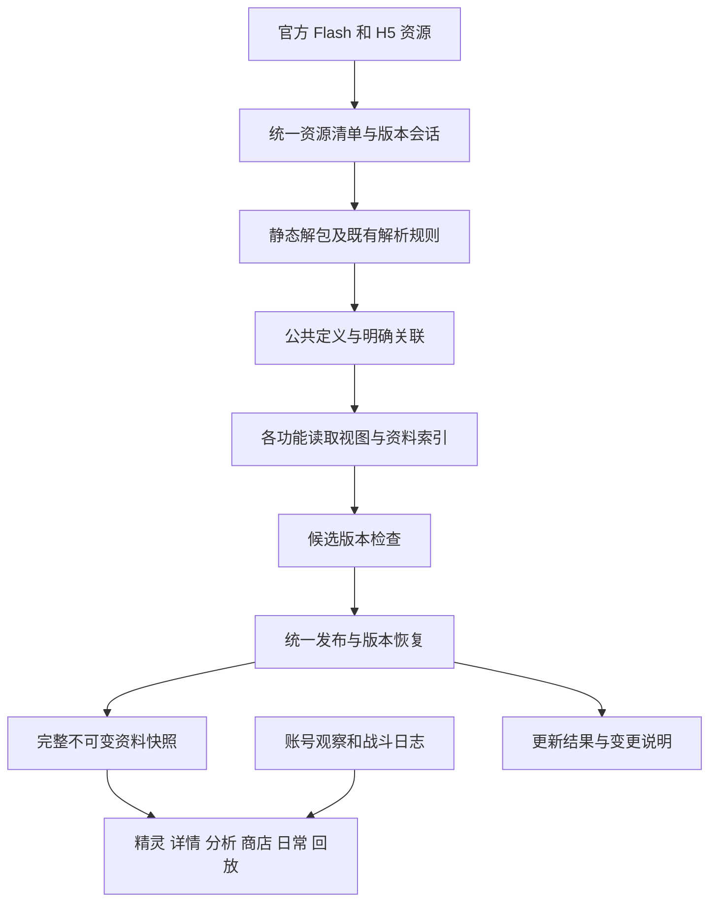
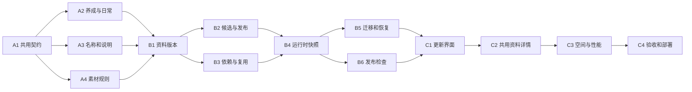

# 工作台共享资料与更新系统改造计划

制定日期：2026 年 10 月 14 日。目标是让一次官方资料更新能够在整个工作台一致生效，让同一对象在不同页面得到一致解释，并使更新、失败恢复和版本追溯都有明确结果。

本计划分三轮实施：统一读取规则，建立完整版本发布与恢复，完善更新结果及资料查询体验。第一轮 A1 至 A4 已完成并覆盖日常工作台，见 [第一轮实施记录](共享资料第一轮实施记录.md)。第二轮 B1 至 B6 的实现及最终验收、安装结果见 [第二轮实施记录](共享资料第二轮实施记录.md)；第三轮实现和最终交付入口见 [第三轮实施记录](共享资料第三轮实施记录.md)。已完成的接入盘点、官方依据和验收记录作为实施基线，继续复用。

## 一 实施范围与已确定原则

1. **整个工作台继续使用同一个共享公共数据集。** 根目录保持 `KQPetData`；精灵、技能、回放、商店、日常及图片的不同文件和读取视图属于这个数据集。
2. **保留现有功能和已确认依据。** 复用官方 SWF、AS、XML、H5 配置、已有字段解释、关联规则和真实战报。不重复从头研究已有结论，不把某个检查器未覆盖重新写成机制未知。
3. **公共定义与账号事实各守原有职责。** 更新按钮处理公共资料；装备、背包余额、次数与战斗过程使用真实账号记录或战报。此次不增加自动账号查询，不重做服务端伤害或概率计算。
4. **原始字段和来源可追溯。** 官方为空、原文缺项、尚未支持的结构、单项检查未覆盖分别记录。原始记录不能因界面简化而丢失。
5. **用官方关联替代名称猜测。** 同号不同类型不合并，Flash/H5 的差异保留来源和适用范围。已有明确的用户排除规则继续有效。
6. **默认仍由用户手动更新。** 启动和切页只读取本地资料；查看缺失图片沿用按需补图。数据更新与软件更新分别展示。
7. **用户界面显示对象和结果。** 技术编号、字段名、散列、代码路径进入诊断详情或导出记录，普通界面使用精灵原名、技能名、效果说明和清楚的状态。
8. **按既定范围建设回放。** 多人组队、战后奖励、剧情与嵌入事件、开战道具结果、联盟兵工厂继续排除。现有九宫格、动作过程、效果提示、死亡复活时间线等功能属于必须保持的行为。

正式基线见 [官方数据接入与使用总表](官方数据接入与使用总表.md) 和 [机器清单总索引](../qa/data-integration-audit-20261014/integration-register.json)。盘点绑定的程序版本是 `3.2.0-cf604069e362-20261014T023659Z`。施工开始只检查相对该基线的新变化，受影响的部分再更新盘点。

## 二 完成后的整体结构



“统一”落实为一份资源登记、一套明确的字段解释、一份已应用版本清单和一个公共资料发布入口。界面需要的轻量视图继续存在；首轮沿用已验证的 JSON/brpack，不在同一轮强行更换全部存储格式。

### 资料如何表示

| 对象 | 计划中的表示与约束 | 使用方式 |
|---|---|---|
| 公共定义 | 以资料类型、官方命名空间、原始标识共同确定身份 | 精灵、技能、Buff、词条、养成、物品、活动和素材分别查找 |
| 跨表关系 | 保存明确端点、关系类型、读取规则及依据引用 | 区分“技能槽引用”“条件播放”“皮肤还原”“静态召唤配对”等关系；不扩写成本场因果 |
| 官方原文 | 保存可定位的原字段、文本和内容散列 | 详情可查原文，诊断可回到实际资源；同一原文由引用复用 |
| 已确认解释 | 绑定解析器版本和已有官方消费依据 | 统一给出名称、类别、限制、文字替换和显示条件 |
| 检查结果 | 单列结构、引用、原文核对、战报回归各自状态 | 某项未检查不覆盖其他已确认结论 |
| 本场或本账号事实 | 保持现有独立的观察时间、会话与来源 | 静态资料只解释实际收到的值，不代替缺失的装备或战斗记录 |
| 界面视图 | 从同一个资料快照生成，携带其版本身份 | 一次分析、一次详情准备、一份打开的战报都固定使用完整快照 |

公共定义的统一不能压平差异。技能详情需要的 H5 文本和 Flash 回放需要的播放定义可以同时保存；只有已有依据确认等价的字段才抽成共用事实。精灵原名、皮肤外观、形态兼容集合分别表达，不能互相代替。

### 共用读取接口

拟新增一个公共资料快照接口及相应的解析结果类型，向现有 `PetMetadataView`、技能展示、养成计算、商店和回放提供同一版本下的查询。首轮用适配器包住现有已验证视图，再逐项收回页面里的重复解析。

优先统一五组查询：精灵身份与原名、技能和词条说明、星轮与养成记录、素材定位、更新和来源状态。回放动作执行、技能详情说明、养成战力属于不同业务契约，继续各自遵循已确认规则。

界面获取的是可展示结果和必要状态。精确说明缺失时，保留官方原文或显示“暂无官方说明”；不自动换成相近名称的说明。原始记录在展开详情中仍可查。

## 三 三轮交付与先后关系

| 轮次 | 完成后用户能得到什么 | 任务 | 进入下一轮的条件 |
|---|---|---|---|
| 第一轮 统一读取和写入规则 | 日常更新入口一致；星轮与技能解释在不同页面一致；名称回退和静态说明来源清楚 | A1 至 A4 | 已知读取差异关闭，原功能和资料保留范围通过回归 |
| 第二轮 完整版本发布和恢复 | 有关资料一起生效；中断可恢复；上一版本可恢复；失败原因和真实生效状态可追踪 | B1 至 B6 | 迁移、发布、中断恢复、关联失败及多快照场景通过检查 |
| 第三轮 更新结果和资料查询体验 | 一个主要更新入口；能看懂变化；各页进入同一份资料详情；空间与耗时有实际报告 | C1 至 C4 | 界面与全部功能验收完成，按现有发布流程覆盖日常工作台 |



每轮都形成可审查的代码、相关测试和实施记录。第一轮完成后可以交付兼容现有存储的修复版本；第二轮的版本发布与迁移必须作为完整功能一起交付，不能只上线半条写入链。第三轮完成最终整体验收。耗时在各轮首次实测后记录，不预先承诺未经测量的提速或压缩比例。

## 四 第一轮具体任务

### A1 固定共用读取契约

以盘点清单为起点，将每个仍在使用的业务表、字段和关系分配给明确的解析结果或保留区。登记字段的类型、空值含义、官方命名空间、关联方式和现有证据入口。首批覆盖精灵身份、十类技能槽、词条、星轮、神源兽计划、图片定位及回放解释。

现有 15 张精灵业务表、11 张技能业务表、回放 34 个顶层键及其枚举路径都必须有去向；原始导出和来源包装单列。不能通过删字段使模型“变简单”。新官方资料按结构接入，不把当前条数固化成游戏上限。

**涉及位置：** [catalog_types.h](../src/domain/catalog_types.h)、[pet_metadata_view.cpp](../src/domain/pet_metadata_view.cpp)、[pet_detail_catalog.cpp](../src/application/catalog/pet_detail_catalog.cpp)、[pet_skill_catalog.cpp](../src/application/catalog/pet_skill_catalog.cpp)、[battle_replay_catalog.h](../src/contracts/battle_replay_catalog.h)。共用契约文件拟放在 `src/contracts/`，纯解释逻辑放在 `src/domain/`。

**验收：** 输出字段去向表无未分配业务项；身份不能跨命名空间误连；官方空说明保持为空；被保留的原始记录能按来源找到。页面内的新实现通过共用接口读取资料。

### A2 统一星轮解析与日常写入

星轮记录采用一个已确认的解释函数，详情、战力与培养缺口共同调用。节点零及两段/三段格式按已有官方消费依据处理，非法数据继续被拒绝。测试同时比较三个消费者，避免只验证一个页面。

日常页“刷新”负责账号进度读取；公共目录由统一数据更新服务维护。移除正常用户流程对 `KQPET_OFFICIAL_UNPACK_ROOT` 旧 AS 导入的调用。本地导入如仍需供开发使用，必须先生成候选并通过相同校验，不能直接改现用文件。

将已有官方依据明确的日常额度和解释规则登记到公共规则配置中。可从当前资源提取的值进入正常更新；已经确认但暂以固定规则表达的值，绑定相关消费者检查。官方输入结构变化时保旧并记录，不能仅把 UI 常量换个文件存放就声称已经动态更新。

统一公共与离线生成器的字典格式标记，通过共用契约常量生成，避免同一规则产出不同 schema 标记。

**涉及位置：** [pet_detail_preparation.cpp](../src/domain/pet_detail_preparation.cpp)、[pet_power_calculator.cpp](../src/domain/pet_power_calculator.cpp)、[pet_cultivation_requirements.cpp](../src/domain/pet_cultivation_requirements.cpp)、[routine_overview_controller.cpp](../src/application/routine/routine_overview_controller.cpp)、[routine_overview_window.cpp](../src/ui/routine/routine_overview_window.cpp)、[catalog_io_service.cpp](../src/application/catalog/catalog_io_service.cpp)、[public_routine_updater.py](../tools/public_routine_updater.py)、[generate_pet_detail_data.py](../tools/generate_pet_detail_data.py)。

**验收：** 星轮合法记录的三处结果一致；日常刷新不再用旧结构覆盖新公共目录；离线与公共生成器的格式一致；原有任务、账号进度和玩法剩余显示继续工作。

### A3 清理名称推断和静态说明回退

技能标题使用明确槽位、完整标签及已确认关联。词条优先按准确标识和已核别名查找，移除去罗马后缀或子串匹配后直接借用其他说明的行为。无法准确关联时显示当前原文和缺项状态。

内置技能补充拆清来源：有明确官方出处的解释可按源版本重建；基于本地关键词生成的简评退出默认展示，不冒充官方结论。仍需保留的历史补充明确绑定当时资料版本，不能覆盖当前官方说明。

商店的自选/任选判断优先读取已接入的礼包、奖励分支和消费者规则。无法由结构确认的项目保留原文并进入人工选择范围，停止仅凭描述自动排除或自动推荐。四个已明确排除的活动来源保持原范围，避免重构改变用户决定。

**涉及位置：** [pet_skill_renderer.cpp](../src/ui/detail/pet_skill_renderer.cpp)、[generate_pet_skill_data.py](../tools/generate_pet_skill_data.py)、[generate_pet_skill_supplement.py](../tools/generate_pet_skill_supplement.py)、[generate_shop_exchange_data.py](../tools/generate_shop_exchange_data.py)、[activity_reward_structures.py](../tools/activity_reward_structures.py)、[public_activity_exchange_updater.py](../tools/public_activity_exchange_updater.py)。

**验收：** 相似名称和不同后缀不会互借说明；当前官方词条优先；本地简评不会被当作官方事实；商店明确支持的项目与用户选择保留，无法判断的项目不擅自归类。回放 Buff 的既有官方分类保持不变。

### A4 统一素材定位和默认版本规则

精灵与星神素材共用已经存在的官方默认版本读取。精灵图片单独更新也检查相关加载器规则，消除 `2000` 常量缺少自动保障的差异。

新下载优先使用精确 race/face、官方资源键和精确符号。现存按名称登记的历史图片只在官方身份关联能确定时迁为精确键；不能确定的缓存原样保留，普通运行流程不继续按名字寻找新图片。新缺图显示稳定占位并允许重试，不借用另一只精灵的图。

为图片缓存加入来源版本或内容身份，避免更新后旧快照读到同文件名下的新图。官方属性 FUI 和星神符号提取、失败保留可用缓存的行为继续复用。

**涉及位置：** [public_icon_updater.py](../tools/public_icon_updater.py)、[public_data_updater.py](../tools/public_data_updater.py)、[public_resource_session.py](../tools/public_resource_session.py)、[image_service.cpp](../src/application/images/image_service.cpp) 及 `PetImageCache`。

**验收：** 精灵图片单独更新也能发现默认版本规则变化；同名精灵、皮肤及高位 face 例外按官方身份处理；已有合法图片可用；没有依据的名称映射不会引发错误新下载。

## 五 第二轮具体任务

### B1 定义资料版本与磁盘组织

为现有公共分块增加统一版本清单，登记内容位置、散列、大小、格式、解析器与规则身份、依赖、来源记录和相应质量报告。未改变的对象复用；检查时间与更新尝试记录独立保存，内容和来源身份未变化时不创建重复资料版本。

目标目录如下，均在原 `KQPetData` 内。第二轮采用的具体结构以实施记录为准。

```text
KQPetData/
  public/
    current.json                 当前公共资料版本指针
    releases/<revision>/         不可变版本清单
    objects/<content-hash>/       被版本清单引用的数据对象
    transactions/<attempt>/      未发布的候选与恢复记录
    reports/                     最近检查和应用记录
    source-cache/                有界的已核原材料与提取缓存
  catalog/                       迁移期旧文件及现有用户选择记录
  images/                        共用素材缓存，逐步使用精确版本键
  data-tools/                    继续共用的处理工具
  原有账号和战报目录             保持原职责
```

这里的公共 `current.json` 与程序 `KQPetRuntime/active.json` 各自管理资料和程序，不能混用。完整版本至少包含原七类资料的引用和状态；首次缺失的分块可引用已验证内置基线，并明确其来源，不能记成当天新下载。

**验收：** 校验清单能发现对象缺失、散列错误、格式不匹配和依赖不完整；不同版本复用相同对象；检查时间变化不会单独复制业务数据。首轮保留 JSON/brpack 载荷，减少迁移变量。

### B2 改为候选构建与统一发布

Python 更新器在事务目录生成候选、原文核对和变更报告，停止在每个类别结束时直接覆盖现用公共文件。由应用中的统一发布流程负责最后切换。

发布步骤固定为：

1. 读取当前资料版本并取得更新锁，记录本次所依据的旧版本。
2. 准备官方资源并集、实际版本和字节；在事务目录生成受影响的输出。
3. 按依赖范围完成结构、原文、关系、回归和来源稳定性检查。
4. 后台预读完整候选快照，确认现有 C++ 消费者能够接受。
5. 再核当前指针仍是本次基线；冲突时重新安排候选，不覆盖别人刚应用的版本。
6. 持久保存不可变对象与清单，通过存储服务原子替换公共当前指针。
7. 在 Core 中发布一个完整快照句柄，再通知各消费者和更新界面。

Python 负责下载与候选构建，`CatalogIoService` 及拟新增的公共版本服务负责后台准备、应用与发布。GUI 线程不读取大文件，也不分别替换各业务目录。命令行集成测试使用同一发布逻辑，不能保留绕过发布检查的正式写入入口。

磁盘切换与进程内通知不能伪装成一个不可中断步骤。若进程在指针切换后退出，下次启动读取已提交的新版本；若当前进程通知失败，保留其旧快照并标明“资料已保存，当前会话尚未应用”，进入恢复重载。只有内存发布完成才显示“已应用”。

**涉及位置：** [public_data_updater.py](../tools/public_data_updater.py)、[public_battle_replay_updater.py](../tools/public_battle_replay_updater.py)、各分类更新器、[data_update_service.cpp](../src/application/runtime/data_update_service.cpp)、[catalog_io_service.cpp](../src/application/catalog/catalog_io_service.cpp)、现有存储服务。新发布服务放在 `src/application/catalog/`。

**验收：** 下载、解析、校验、预读或提交任一步失败，都不会暴露半套资料；并发更新不能互相覆盖；取消发生在提交前则保持旧版，提交开始后应完成切换或明确记录恢复状态。

### B3 按依赖关系决定重建和失败范围

将资源、原表、已确认解释、派生关联和读取视图连接到依赖清单。先采用明确的表级/资源级依赖，后续有实际收益再细化，不从文件名称推测依赖。

单项更新若影响其他视图，自动扩展到必要的关联范围，并在进度中说明“同时同步相关资料”。没有关系的分块可以继续引用旧版。核心定义改变却未能生成关联视图时，该依赖组保留原版；已经检查通过且无依赖冲突的其他组可进入新完整版本，结果显示为部分更新。

一致性要求是引用、定义和规则相互匹配，不要求所有官方文件的发布日期相同。Flash/H5 仍保留各自官方来源；因失败沿用的旧资料明确标注沿用时间和原因。

缓存同时绑定官方内容、提取器、规则和输出格式身份。原文核对继续从独立原始输入读取；不能用候选自己的来源声明替代。当前“未变化也执行”的必要检查保持，只有建立等效且可核验的复用条件后才减少工作。

把已有宽范围消费者字节保护逐项缩小到明确的消费类及其完整依赖闭包。只有数据部分变化而消费语义保持时才允许自动刷新；继承、辅助类、默认值等无法完整覆盖时继续使用原严格保护，不直接放宽整包变化。

**涉及位置：** [public_resource_plan.py](../tools/public_resource_plan.py)、[public_resource_session.py](../tools/public_resource_session.py)、[public_skill_updater.py](../tools/public_skill_updater.py)、[public_battle_replay_updater.py](../tools/public_battle_replay_updater.py) 及对应提取器。

**验收：** 同版本换字节会被发现；改解析器会使相关缓存失效；技能变化触发确有依赖的重建；共享原表失败不会混入新旧矛盾的视图；无关图片失败不阻塞核心资料发布。

### B4 整体发布运行时快照

为目录快照增加统一公共版本身份。一次详情准备、养成分析、商店适用性判断和回放解析都先取得完整快照，计算期间不再动态查询可能已换版的单例数据。

更新时后台准备新快照；旧任务完成后发布结果时，检查它绑定的版本是否仍适用，必要时丢弃旧派生结果并按新版本重算。缓存键纳入实际依赖的公共版本或内容身份，避免更新后命中旧解释。

已经打开的战报继续固定旧快照。用户选择“使用更新后的资料”时，从原战报重新解释并恢复到可确定的动作位置；恢复依据使用动作序号和稳定标识，不能沿用新旧版本下可能不相同的内部帧索引。切换失败保留原战报视图。

完整快照要求版本与引用完整，未使用的回放大对象可以继续延迟加载。已经加载且内容未变的句柄直接复用，其他部分绑定通过检查的不可变对象，按需在后台展开；首次读取仍校验实际字节。不能为了全局版本号而在每次打开设置时加载全部回放资料。

图片索引及完成后的素材也必须使用明确身份。暂未取得新版图片时允许占位或明确的旧图后备，不把旧图片的来源改记为新版。

**涉及位置：** [application_runtime.cpp](../src/application/runtime/application_runtime.cpp)、[catalog_io_service.cpp](../src/application/catalog/catalog_io_service.cpp)、`InventoryPublisher`、`PetDetailPreparationService`、分析控制器、[battle_replay_page.cpp](../src/ui/battle/battle_replay_page.cpp)、`ImageService`。

**验收：** 任一业务操作使用的资料版本一致；更新过程中持续操作界面不混版；旧战报能继续播放；新战报用新资料；旧分析结果不会在新目录上被误当成最新结果。

### B5 迁移 恢复 与清理

第一次迁移读取现用公共文件、实际散列和安装收据，为其建立一个基线版本。保留文件各自的真实来源年龄；缺少来源的旧日常文件继续标为历史来源未登记，不借其他文件的来源替它补证明。

迁移先在隔离目录完成并试读，再启用新的公共版本入口。原 `catalog` 文件在兼容期保留，只作旧版本恢复和只读兼容。新程序启用版本入口后停止从旧路径接收正常写入；旧导入和新发布不能长期并行覆盖。

常规至少保留当前和上一份可用公共版本。正在使用的旧快照、未完成事务和用户保留的版本都算有效引用。删除对象前按清单引用计算，只有完全无引用的对象才能回收；多进程引用的可靠识别没有完成前，运行期间不清理可能仍被使用的对象。

恢复上一版本同样需要检查格式兼容和快照可读性。程序回退与资料回退采用兼容记录配对，避免旧程序读取新格式后自行写坏数据。账号缓存、商店选择、图片原缓存和原版客户端不作为公共版本清理对象。

**验收：** 旧目录可无损导入；迁移中断后原版仍可用；重复迁移不重复复制；恢复后全工作台使用一致旧快照；引用中的对象不被删；旧程序恢复路径实际演练通过。

### B6 扩展统一发布检查

保留现有检查职责：精灵结构/差异与养成规则、技能独立原文核对、回放原文核对和真实战报回归。把已有证据直接接入缺少的自动断言，先覆盖此次修改的身份、星轮、词条、日常及素材路径。

增加整体候选检查：所有分块可读、版本与依赖完整、跨视图明确关联不冲突、保旧范围有依据、报告绑定实际候选内容。允许的官方空文或有原文证明的缺项继续保留；新增错连、未解释的字段消失或身份退化不能静默通过。

更新收据分开保存“检查过什么”“候选是否通过”“磁盘是否提交”“当前会话是否应用”。旧全局状态不再覆盖当前实际生效事实。报告绑定事务、资料版本、检查器及输入身份，供更新 UI 和诊断共用。

**涉及位置：** [public_catalog_quality.py](../tools/public_catalog_quality.py)、[public_skill_fidelity.py](../tools/public_skill_fidelity.py)、[public_replay_fidelity.py](../tools/public_replay_fidelity.py)、[public_replay_regression.py](../tools/public_replay_regression.py)、现有原生回归工具与新公共版本检查器。

**验收：** 检查通过但未发布不会显示更新成功；报告与候选不匹配会拒绝；官方文本正常变化能够通过；新缺陷不会因“允许缺项”而绕过检查。

## 六 第三轮具体任务

### C1 重做设置中的更新结果

主要入口改为“检查并更新”，分类选项放进“高级更新”。保留“重试失败项”“查看变化”“恢复上一版本”和诊断导出。高级单项更新提示实际需要同步的依赖范围。

设置页从持久的更新收据恢复状态，关闭再打开不会重置成“尚未检查”。首页同时显示最近检查、当前已应用资料、仍沿用旧资料的部分及图片补齐进度。

进度按“准备工具 → 获取官方资源 → 解析资料 → 检查 → 应用”展示。能计数时显示真实完成项；无法预知总量时显示阶段状态，不伪造百分比。错误信息说明受影响的功能、目前保留的内容和下一步可执行动作。

变更说明按用户对象组织：精灵资料、技能与效果、养成、兑换活动、图片。新增、内容修订、官方删除或停止显示分别列出；可展开查看旧新说明。隐藏字段只进入技术详情，不生成满屏编号差异。

**涉及位置：** [pet_settings_dialog.cpp](../src/ui/workbench/pet_settings_dialog.cpp)、[data_update_service.cpp](../src/application/runtime/data_update_service.cpp)、[application_runtime.cpp](../src/application/runtime/application_runtime.cpp)。

**验收：** 成功、无变化、部分更新、失败保旧、取消、待应用、已恢复等状态均有准确展示；重新打开设置仍对应实际文件；图片失败不把整次核心更新显示为失败。

### C2 共用资料详情与关联导航

精灵、技能、Buff、养成和商店中的资料入口统一到可复用详情组件。默认展示名称、官方说明、明确适用条件和相关对象，保留各业务需要的上下文。

回放格子及效果提示继续突出本场事实；点击说明时能看同一资料版本下的官方解释及已有明确关联。资料中“存在这个规则”与本场“已经发生”使用不同字段提供，不能因关联导航而生成本场效果。

同一对象在列表、详情和回放中显示精灵原名；皮肤或形态作为附属信息。需要查询原文时可展开“资料来源”，技术编号与解析详情放在更深一层，不挤占九宫格。

**涉及位置：** `src/ui/detail/`、`src/ui/battle/`、`src/ui/shop/`、共用公共资料查询接口。保留现有布局和操作习惯，逐项替换重复的解释内容。

**验收：** 同版本、同对象、同含义的解释一致；不同官方命名空间的同号对象不会串页；关联跳转能够回到原位置；当前回放进度和 Buff 折叠状态不因查看资料被重置。

### C3 体积与性能优化

先测当前实现，再对同一份资料和同一组操作比较。基线中七个主要公共文件合计 **24,931,680 字节，约 23.78 MiB**；该数字不包含图片、工具、活动中间文件、研究归档及更新临时目录。回放压缩包为 4,981,690 字节，展开原文 100,885,236 字节；压缩体积不能当作内存占用。

优先消除跨版本的重复复制，随后按明确等价关系复用共同定义与原文。共同对象共享后，各业务索引按需加载。若保留 JSON/brpack 的读取成本仍明显，再用相同输入做替代存储原型，比较结果后决定；本计划不预先引入新数据库依赖。

记录首次更新、无变化检查、少量资料变化、恢复版本、首次打开回放、资料查询和后台更新时的界面响应。分别统计网络等待、解包、解析、检查、磁盘写入和运行时加载，避免用网络波动评价本地解析优化。

**验收：** 无变化不重复落盘大文件；相同来源不重复存多份；更新临时目录正常收尾；清理不伤及有效版本。提交包含实际磁盘、更新峰值、峰值内存、加载耗时和界面响应的前后对照，发生退化时说明原因并处理，不虚报节省比例。

### C4 完整验收并覆盖日常工作台

完成本轮功能后先冻结源码与文档，再执行现有构建、完整发布测试及客户端验收。沿用 [发布与部署流程](../README.md#高级手动部署标准包)，使用配对的加载器、DLL、manifest 和测试报告，不能单独替换 DLL。

安装目标仍是 `C:\Users\25982\Desktop\11\氪奇Pro-V1.1.4`，数据根仍是其 `KQPetData`。保留上一程序版本及其兼容资料版本、旧目录迁移备份、用户账号数据和个人选择。

客户端正在运行时只暂存程序更新，通过现有启动流程激活，不强制结束用户客户端。部署报告必须分别写明已暂存、已激活、公共资料已应用及当前会话是否已加载，不能将待激活说成已覆盖生效。

**验收：** 在真实工作台验证设置结果、精灵列表、详情、分析、商店、日常、图片与回放；检查断网/失败保旧和恢复入口；安装后再次核对程序和公共版本身份。既有战报足以覆盖的内容直接复用，不要求用户为已知机制反复提供战报。

## 七 发布与失败的具体决策

| 场景 | 预期行为 |
|---|---|
| 官方输入和规则均未变化 | 保持公共版本和业务文件不变，更新最近检查记录 |
| 某个核心定义变化，关联视图成功重建 | 将该依赖组放入完整候选，通过检查后一起生效 |
| 核心定义变化，但相关视图解析失败 | 整个受影响依赖组沿用旧版，不发布互相矛盾的新旧组合 |
| 无关活动解析失败，其他组有效 | 保留该组旧值并显示原因，其他经过依赖检查的组可发布 |
| 图片索引有效，部分素材未取得 | 发布索引与核心资料，缺图补齐可重试；不标记图片已成功 |
| 官方消费者逻辑变化 | 沿既有证据定位受影响范围；不支持时保旧并提示待适配 |
| 更新中途取消或磁盘不足 | 提交前保持旧指针，保留足够诊断；下次可重新准备 |
| 保存对象后、切换指针前中断 | 原版仍生效，未提交对象可恢复验证或在确认无引用后清理 |
| 切换指针后、当前进程通知前中断 | 启动时按已提交版本加载；当前会话状态不虚报已应用 |
| 更新期间另一个进程已换版 | 检查基线身份冲突，不覆盖新版本；重新安排候选或返回重试 |
| 用户恢复上一版 | 先验证兼容与完整性，再完整切换；账号数据保持原状态 |
| 官方网站临时不可用 | 本地已应用资料继续可用，更新时间与失败原因分别显示 |

## 八 必须通过的验收矩阵

| 重点 | 场景与通过条件 | 主要复用位置 |
|---|---|---|
| 资料保留 | 现用业务表、全部原始导出和来源都有去向；合法空文保持 | `qa/data-integration-audit-20261014/`、现有质量检查 |
| 身份与关联 | 原名、皮肤、形态及同号不同命名空间不误连 | 既有身份/消费闭包依据及回放测试 |
| 养成一致性 | 节点零、两段/三段及非法星轮输入在三个消费者中一致 | 详情、战力与培养缺口测试 |
| 技能说明 | 相近名称不借说明；官方精确词条优先；静态简评不冒充官方 | 技能解析与详情展示测试 |
| 商店范围 | 结构明确的奖励保持；个人选择保持；未知判断不自动推荐 | 商店目录、适用性、活动测试 |
| 日常入口 | 账号刷新不改公共目录；公共更新产生完整统一格式 | 日常更新器与目录服务测试 |
| 素材定位 | 默认版本变化、高位例外、同名、缺图重试和旧缓存兼容 | 图片与公共图标测试 |
| 输入变化 | 同版本换字节、解析器变化、入口更新中变版被正确处理 | 资源会话与各更新器测试 |
| 发布完整性 | 每个持久化边界注入中断，结果只能是完整旧版或完整新版 | 拟新增事务与恢复测试 |
| 依赖失败 | 关联组一起保旧，无关组按实际检查结果发布 | 拟新增依赖与候选组合测试 |
| 运行时一致 | 更新时持续打开详情、分析、回放，操作不混版 | 目录 I/O、运行时及 UI 集成测试 |
| 回放保持 | 现有三份更新回归保留；涉及回放解释时再跑相应真实战报和播放检查 | 336 行动、3,093 快照的既有固定回归及 21 份验收战报 |
| 恢复与兼容 | 迁移可重入、程序和资料兼容、引用中对象不被清理 | 新迁移测试及现有部署恢复脚本 |
| 用户结果 | 重开设置仍显示真实状态；部分成功、待应用、失败保旧准确 | 更新 UI 状态与人工验收 |
| 发布绑定 | 实际源码、二进制、报告、数据版本和安装结果一致 | `scripts/test-release.ps1`、发布检查器、部署收据 |

日常开发只跑受改动影响的检查；每轮准备正式发布时执行完整注册测试。已有 114 组通过记录作为旧版基线，不能代替新构建验收，也不将新增测试数量当作质量目标。故障注入和损坏输入仅用于测试，不写入正式公共资料。

## 九 原盘点问题的落实位置

| 已记录项目 | 对应任务 | 完成判定 |
|---|---|---|
| 日常有两个公共文件写入入口 | A2、B2 | 用户流程只有统一公共发布入口 |
| 星轮详情与分析接受条件不同 | A1、A2 | 共用解释函数和三处结果一致性检查 |
| 技能标题与词条仍有名称模糊回退 | A3、C2 | 明确关联或当前原文，不借用相似说明 |
| 精灵图片保留历史名称映射 | A4、B5 | 精确关联迁移；未知缓存留存且不再驱动名称下载 |
| 图片默认版本缺少自动语义检查 | A4 | 精灵图片独立更新也核对既有加载规则 |
| 技能静态补充不随按钮重建 | A3、B3 | 官方补充绑定源版本；本地关键词简评退出默认界面 |
| 部分日常额度仍是 UI 常量 | A2、B3 | 规则进入公共契约，并有来源变化处理方式 |
| 商店排除仍有描述筛选 | A3 | 按结构判断；未确认的项目保留原文与人工范围 |
| 离线与公共字典格式标记不同 | A2 | 同一格式常量、同一验证契约 |
| 部分回放规则以已核常量表达 | A1、B3 | 登记适用消费者与变化保护；保留已确认含义 |
| 全局旧状态与实际安装记录不同步 | B2、B6、C1 | 检查、提交、应用各有收据，界面读取真实状态 |
| 分块提交、设置状态重置和版本提示不准确 | B2、B4、C1 | 完整快照发布、结果持久化、正确解释内容变化 |

## 十 执行方式与交付记录

施工从 A1 开始：读取现有盘点和当前差异，写出共用契约及字段去向表。然后实施 A2 的星轮与日常入口修复，取得第一批可见改进。A3、A4 可在契约确定后并行；发布协议、目录服务和全局状态的修改由同一条集成顺序收口，避免同时改写相同核心文件。

每个任务完成时记录五件事：已修改文件、复用的官方依据、实际验证、资料或程序是否已应用、剩余边界。任务状态只在代码和对应验收完成后更新。

每轮交付包含：

- 源码及必要的资料格式或迁移说明。
- 与本次构建绑定的测试、真实样本和界面验收记录。
- 官方来源、资料版本、规则版本、变更及失败恢复记录。
- 更新的总表、工程交接入口和下一轮剩余任务。
- 如已部署，提供目标目录、程序版本、资料版本、备份位置及实际激活状态。

最终完成条件是：所有用户流程从同一公共数据集取得有版本的资料；已知读取差异解决；有关联的变更一起生效；失败可恢复；普通用户能看懂更新结果；现用工作台完成实际覆盖和核对。单独生成候选文件、测试包或预览界面都不能作为整项完成。

## 十一 接续依据与当前计划状态

| 记录 | 用途 |
|---|---|
| [官方数据接入与使用总表](官方数据接入与使用总表.md) | 当前实际连接、消费者和十二项差异 |
| [盘点机器索引](../qa/data-integration-audit-20261014/integration-register.json) | 来源、字段、代码锚点及现用文件身份 |
| [手动公共数据更新](manual-public-data-updater.md) | 已实现的版本规则、解析范围与质量职责 |
| [工程交接](AI工程交接文档.md) | 用户已确认约束、已有证据与实际部署基线 |
| [架构与代码组织](architecture.md) | Core、Storage、计算与 UI 的现有边界 |
| [部署与发布说明](../README.md#开发打包与高级部署) | 构建、验收、完整包、恢复和客户端覆盖流程 |

当前状态：接入盘点和计划已完成；第一轮 A1 至 A4 的代码、测试与安装事实见 [第一轮实施记录](共享资料第一轮实施记录.md)。第二轮 B1 至 B6 已完成。第三轮 C1 至 C4 的实现、验收和实际安装状态见 [第三轮实施记录](共享资料第三轮实施记录.md) 及其最终机器收据；未通过的验收不得记为完成。
