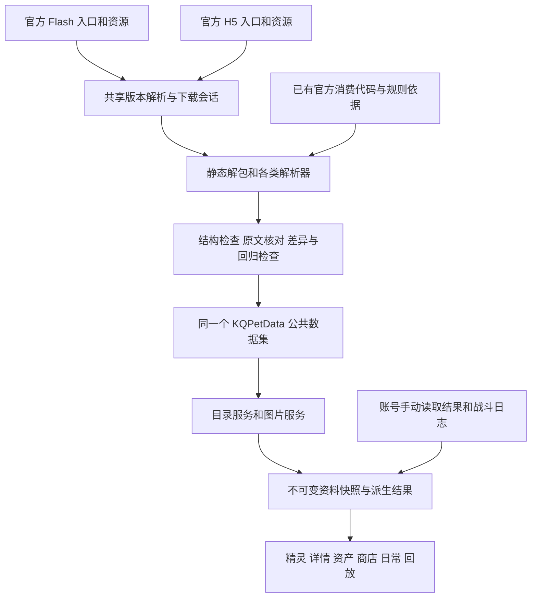

# 工作台官方数据接入与使用总表

本表保留 2026 年 10 月 14 日改造前的实读快照。后续第一轮已处理的差异与新官方日常规则见 [第一轮实施记录](共享资料第一轮实施记录.md)；先读该记录及其实际安装收据，避免把下文的历史差异重新当成当前未处理问题。

盘点日期：2026 年 10 月 14 日。对象是整个工作台共用的官方公共数据集，包括精灵、养成、技能、回放、商店、日常及图片。本文把官方输入、解析入口、输出字段、实际消费者和已有证据连起来，作为后续接续开发的入口。

本机共享根目录是 `C:\Users\25982\Desktop\11\氪奇Pro-V1.1.4\KQPetData`。实际启用版本为 `3.2.0-cf604069e362-20261014T023659Z`；已安装 DLL 与此前验收记录一致，运行代码、解析器和数据资产也与该构建清单一致。此后变更的是工程文档。完整文件散列与当前目录快照见 [盘点快照](../qa/data-integration-audit-20261014/dataset-snapshot.json) 和 [构建对应关系](../qa/data-integration-audit-20261014/compiled-source-binding.json)。

**所有模块使用同一个共享公共数据集。** 下文的七个更新分类、多个 JSON 文件及回放压缩包，是这个数据集的存储分块和读取视图。它们并不是独立维护的数据源。一个视图没有直接读取某字段时，必须同时查看其他视图或派生结果，不能据此认定整个功能没有使用该资料。

已有官方消费规则和研究结论继续有效；`notChecked`、某次回归未覆盖等只描述对应自动检查的范围。只有相关官方定义或消费代码变化、证据矛盾、实际缺陷，才需要重新核查受影响部分。本次是读取源码、现用公共文件和已有证据的接线盘点，没有重新运行网络更新、游戏登录或账号查询。

## 共享数据的完整流向

官方公共定义提供名称、配置、费用、可用规则、技能解释及客户端播放规则。账号当前装备、材料余额、已用次数和战斗里的生命变化来自各自的账号记录或战报；这些值不会由设置里的公共数据更新替账号下载或推测。

| 环节 | 代码入口 | 实际行为 |
|---|---|---|
| 数据根 | `src/extension/extension_context.cpp:56` | 优先使用 `KQPET_DATA_ROOT`，否则使用客户端目录下的 `KQPetData`；工作台、图片、后台存储共用该根 |
| 设置按钮 | `src/ui/workbench/pet_settings_dialog.cpp:280` | “全部检查更新”和七个分类按钮发出同一个 `dataUpdateRequested` 信号 |
| 请求调度 | `src/extension/extension_context.cpp:575`；`src/application/runtime/application_runtime.cpp:689` | 请求交给同一个后台更新服务；与正在进行的更新、补图、缓存管理协调 |
| 更新工具准备 | `src/application/runtime/data_update_service.cpp:117` | 从当前工作台内置资源导出解析器、基线、回放依据包、原生回归工具及依赖，再启动公共更新脚本 |
| Python 与解包工具 | `tools/bootstrap-public-data.ps1`；`tools/public_data_updater.py:209` | 准备固定散列的便携 Python、Java/JPEXS；这些是处理工具，不是游戏数据来源 |
| 资源并集 | `tools/public_data_updater.py:575`；`tools/public_resource_plan.py:42` | 汇总固定依赖、共享文件和内置后备中记录的历史引用；所选分类的固定依赖先统一准备，动态引用按实际配置继续追加 |
| 解析与检查 | `tools/public_data_updater.py:605` | 各解析器按既有官方规则生成共享数据的对应分块，完成相应检查后提交 |
| 写入与结果 | `tools/public_data_updater.py:163`、`:707` | 单文件临时写入后原子替换；保存质量与更新记录。当前是按分块提交，成功部分可生效，失败部分保留原值 |
| 后台重读 | `src/application/runtime/application_runtime.cpp:245` | 成功或未变化的分类触发目录重读，图片分类触发图片索引重读 |
| 发布与使用 | `src/application/catalog/catalog_io_service.cpp:728` | 将验证后的不可变快照发布给各消费者；精灵资料变化通知分析重新派生，资料快照传给列表与详情 |
| 回放快照 | `src/application/runtime/application_runtime.cpp:700`；`src/application/catalog/catalog_io_service.cpp:194` | 优先读共享压缩包，无包时兼容 JSON；初次缺失可用内置后备。打开的战报固定其资料快照，新打开的战报使用新快照 |

商店页的“更新兑换项目/适用精灵”同样调用上述入口，只选择 `shop`。日常页的“刷新”另有一条历史本地导入路径，见后文的接线差异，不能与设置更新混为一谈。

## 官方资源入口和版本规则

| 来源 | 入口与版本选择 | 数据处理 |
|---|---|---|
| Flash 公共包 | [官方 Flash 入口](https://aoqi.100bt.com/play/start.xml) 的 `v` 指定 `versiondata~版本.swf`；版本表再应用 `u/f` 覆盖 | 下载 `aoqi.100bt.com/play/` 下实际资源。引导加载器使用入口版本，模块加载器按模块版本表处理；这两个依据分别保留 |
| H5 公共包 | `aoqi.100bt.com/h5/start~时间戳.json` → `version~版本.json`；应用 `start.files`，按 `.mix` 优先规则选资源 | 核对已审核的 `js/main.js`；读取 AQZ/JSON 以及作为消费依据的 JS。未列版本时按已核实加载规则选择默认版本 |
| AQZ | `config/*.aqz` | 有界 ZIP 解包，逐成员记录文件名、长度、散列；拒绝路径越界、缺少必要输入及不支持的结构 |
| SWF 内嵌配置 | 官方 SWF 的二进制标签和 SymbolClass | 有界处理 FWS/CWS/ZWS，提取明确绑定的 XML/二进制配置，不执行游戏脚本 |
| ActionScript 配置 | 官方包中明确选定的类 | JPEXS 静态导出；解析已支持的字面量、构造器、常量表和明确调用关系，不运行 ActionScript |
| FUI 与 PNG | 官方属性图标包、实际活动面板、星神/精灵素材 | 按目录与精确符号提取 PNG 或界面文字；活动期限使用有实际绑定的界面字段 |

按全部更新范围合并当前代码声明，固定清单是 **101 个资源身份**：81 个 Flash SWF、2 个 FUI、1 个仅作版本依赖的资源，以及 17 个 H5 文件（7 个 AQZ、7 个 JSON、3 个 JS）。回放在其中声明 71 个 Flash 与 8 个 H5 依赖；71 个 Flash 中有 44 个称号独立资源。单独更新只预取所选分类依赖；回放源包准备仅在所选范围含回放时执行。

这些数字描述固定声明，不是全游戏资源数量，也不是每次单独更新的下载数量。加上现用资料和内置后备记录的动态/历史引用，本次清单有 **7,919 个去重资源身份**；历史引用仍保留其历史身份，不自动视为本次下载。完整清单、使用分类和原来源位置保存在 [资源清单](../qa/data-integration-audit-20261014/resources.json)。

同一轮中，相同官方 URL 的下载和相同 SWF/类的导出共用缓存。版本字符串与实际字节散列都参与判断，同版本换字节仍可触发重建。临时完整下载和解包目录在更新结束后清理。回放依据 ZIP 保存的是 744 个可移植构建输入，展开共 128,719,311 字节；它不是第二套运行数据，也不要求用户安装原研究目录。

## 共享数据的存储和用途总览

数量来自本次读取的现用公共文件，作为当前快照保留。各业务表的含义和消费链见后续明细，来源和统计包装不计作独立游戏定义。

| 设置分类 | 共享存储 | 当前主要内容 | 主要使用位置 |
|---|---|---|---|
| 精灵与养成资料 | `catalog/pet-detail-data.json` | 精灵 9,722；星神 89；元魂定义 652；神源兽定义 77；星轮节点 490；物品 1,857；属性 29；职业 43；货币 63；升星计划 3；升阶计划 24；组合职业规则 7；普通源兽 114；传说石 23；潜能 36 | 精灵列表、养成详情、战力与缺口分析、材料名称、商店适用判断、资产推荐 |
| 精灵技能资料 | `catalog/pet-skill-data.json` | 精灵 9,722；技能 20,777；词条 248；精简 Buff 31,267；组合关联 19；变身定义 145；英雄原表 395；通灵原表 733；灵初/神运各 1 个规则根；天觉原表 28 | 技能详情、条目说明、召唤/携带与契约关系展示；部分字段保留供其他阶段或查询使用 |
| 战斗回放资料 | `catalog/battle-replay-catalog.brpack` | 完整技能 21,155；Buff 34,486；精灵及机制资料各 9,722；属性 36；技能执行 8；Buff 执行 459；组合配置 103；另含展示、通灵、变身、小神龙、养成引用及资源依据 | 战报解析、状态与动作过程、九宫格展示、名称/原名、效果提示、资料与原文查询 |
| 兑换商店 | `catalog/shop-exchange-data.json` | 合并商店 47；独立活动中间表记录 146 个模块和 41 个商店 | 商店列表、费用/限次、适用精灵、指定养成筛选、资产与兑换建议 |
| 精灵图片索引 | `catalog/pet-image-index.json` 与 `images/pets/` | 外观索引 9,723；高位外观例外 20 | 精灵卡片、列表和详情头像；已有图片复用，缺图按需提取 |
| 星神与属性图标 | `catalog/public-icon-index.json`、`images/stargods/`、`images/attributes/` | 星神图标 89；属性图标 28 | 详情星神槽、属性标识和相关界面 |
| 日常与活动 | `catalog/routine-overview.json` | 现存文件含 14 个任务、43 个活动、日周奖励档位各 5 | 日常/活动概览与账号进度结合；当前文件是历史简化结构，设置更新器可生成更丰富结构 |

活动中间输出还包括 `activity-exchange-data.json`、`activity-evolution-data.json` 等，仍属于同一个共享数据集。`shop-selection.json` 是用户的选择记录，更新公共定义时保留其选择。`public-update-status.json`、`public-resource-manifest.json` 和质量报告是更新记录，不是业务定义表。

目前共享回放包为 **4,981,690 字节**，其原始 JSON 为 **100,885,236 字节**；读取时校验长度与散列并在内存解析，不需要长期保存展开 JSON。技能视图和回放视图的表结构、官方消费路径及用途不同，条数不同不能直接判成漏数据，完整原始定义和精简展示规则均保留在明细中。

## 解析和使用明细

本节按业务用途连接输入、输出和消费者；逐字段代码位置及来源散列同时保存在机器可读清单，便于后续直接查用。

<!-- BEGIN_AUDIT_COMPONENT_DETAILS -->

### 精灵与养成：15 张业务表

Flash 基础/增量字典、服务内嵌 XML、明确配置类及物品/货币表，经 `generate_pet_detail_data`、`public_names_updater`、`public_cultivation_supplement` 形成基础资料视图。增量字典只有时间戳严格较新才覆盖。公共定义与已收到的账号养成状态在 Domain 层结合，列表、详情、商店和资产分析复用派生事实。

| 资料 | 官方输入与关联 | 输出字段 | 工作台如何使用及保留范围 | 入口 |
|---|---|---|---|---|
| 基础身份、原名、时代与品级 | PetDictionaryDataContents/Update.datas: create参数[0,1,8,9,28,42,53]；按update.timestamp严格较新规则合并 | `pets[id].name/attributes/jobs/sign/groupRaceId/quality` | 精灵列表/详情原名、品级、时代、属性职业，商店/资产共享事实 同一公共数据集的基础身份视图；不是技能或皮肤名字相似匹配。 | 解析：[generate_pet_detail_data.py:105](../tools/generate_pet_detail_data.py) 消费：[pet_metadata_view.cpp:289](../src/domain/pet_metadata_view.cpp) |
| 最大等级、星神槽上限与星轮突破条件 | create[30]=maxLevel,[62]=astrolabeBreakCosts,[63]=stargodSlotMaxLevel | `pets[id].maxLevel/stargodSlotMaxLevel/astrolabeBreakCosts` | 星神最高合法槽等级、潜能战力复核、商店突破资格/材料判断 | 解析：[generate_pet_detail_data.py:130](../tools/generate_pet_detail_data.py) 消费：[pet_power_calculator.cpp:270](../src/domain/pet_power_calculator.cpp) |
| 属性枚举 | PetAttr.enum__(id,name) | `attributes[id]，另加0=全部筛选标签` | 属性显示与筛选 不是属性克制计算公式 | 解析：[public_names_updater.py:33](../tools/public_names_updater.py) 消费：[pet_metadata_view.cpp:306](../src/domain/pet_metadata_view.cpp) |
| 职业及攻击类型 | PetJob.enum__(id,name,attackType,shortName)，PetAttackType别名 | `jobs[id] + stargods[*].limitJobs` | 职业显示、星神合法配置限制 不把未确认rt当职业 | 解析：[public_names_updater.py:33](../tools/public_names_updater.py) 消费：[pet_metadata_view.cpp:317](../src/domain/pet_metadata_view.cpp) |
| 组合职业 | PetJob.FUSION_JOBS name/jobs嵌套职业组 | `fusionJobs完整数组` | 组合职业显示 已纳入逐项差异检查，不是未解析 | 解析：[public_names_updater.py:55](../tools/public_names_updater.py) 消费：[pet_metadata_view.cpp:322](../src/domain/pet_metadata_view.cpp) |
| 星神 | Sgsv3Config XML:s@defineId/name/supplyExp,l@level/battlePower；StarGodItem/StarGodType；PetJob职业组 | `stargods[id].name/supplyExp/battlePower[level]/type/quality/limitJobs/limited/changeable` | sgs/sgsp星神详情、已有可达/至高战力、缺星/升槽/调整装备建议、星神统计 supplyExp和limited本次未见业务直接读取，仍有类型校验/保留；公共表不是账号持有，不自动装备。 | 解析：[generate_pet_detail_data.py:208](../tools/generate_pet_detail_data.py) 消费：[pet_detail_preparation.cpp:521](../src/domain/pet_detail_preparation.cpp) |
| 职业元魂与专属元魂 | PetBadgeConfig XML:s@defineId/name/type/battlePower/materialStrToActivate；l@level/battlePower/materialStrToUpgrade | `badges[id].name/type/maxLevel/levels[level].battlePower,cost/activationCost/battlePower(专属)` | badge槽等级/觉醒展示，目标等级及专属觉醒成本，培养缺口/商店建议 bsv战力分项仍读回包；升级成本从当前+1累加到目标。 | 解析：[generate_pet_detail_data.py:355](../tools/generate_pet_detail_data.py) 消费：[pet_detail_preparation.cpp:490](../src/domain/pet_detail_preparation.cpp) |
| 星轮节点 | AstrolabeConfig XML:s@defineId/name/exclusive/lightUpCost/battlePower/locatedTypeId/isTBD | `astrolabe[id].name/exclusive/lightUpCost/lightUpMaterials/battlePower/locatedType/isTBD` | 节点点亮/选中、节点战力与灵初突破加成、未点亮精华需求 当前状态取astrolabe/astrolabebr回包；节点0/2段接受条件在消费端有差异，见observations。 | 解析：[generate_pet_detail_data.py:321](../tools/generate_pet_detail_data.py) 消费：[pet_detail_preparation.cpp:501](../src/domain/pet_detail_preparation.cpp) |
| 神源兽与对应消耗源兽 | SE_SacredEquipmentConfig id/name/sourceId；Equipment4PetItem(type24)名称；E4PV2_EInfos精确ID补名 | `sacredEquipment[id].name/sourceId/sourceName/sourceNameKnown/sourceNameSource` | shenjue当前名称/星阶上限、对应源兽材料名和需求量 sourceNameKnown/Source保留溯源未直接显示；神源兽定义与消耗源兽ID区分。 | 解析：[generate_pet_detail_data.py:485](../tools/generate_pet_detail_data.py) 消费：[pet_detail_preparation.cpp:369](../src/domain/pet_detail_preparation.cpp) |
| 神源兽升星计划 | SE_StarUpgradeConfig：SE_StarDefine及SE_StarLevelDefine | `sacredStarPlans[id].maxLevel/levels[level].battlePower,cost,equipmentCount` | 按账号planId判断上限；Stage逐档equipmentCount计算对应源兽需求 levels.battlePower和完整cost保留；当前需求摘要不列全部金币等公共成本，不等于计划未解析。 | 解析：[generate_pet_detail_data.py:521](../tools/generate_pet_detail_data.py) 消费：[pet_metadata_view.cpp:426](../src/domain/pet_metadata_view.cpp) |
| 神源兽升阶计划 | SE_StageUpgradeConfig：SE_StageDefine及SE_StageLevelDefine | `sacredStagePlans[id].maxLevel/levels[level].battlePower,cost,equipmentCount` | 按账号planId判断上限；Stage逐档equipmentCount计算对应源兽需求 levels.battlePower和完整cost保留；当前需求摘要不列全部金币等公共成本，不等于计划未解析。 | 解析：[generate_pet_detail_data.py:521](../tools/generate_pet_detail_data.py) 消费：[pet_metadata_view.cpp:430](../src/domain/pet_metadata_view.cpp) |
| 普通源兽 | E4PV2_EInfo(id,name,...,attr,...) | `sourceBeasts[id].name/attr` | 详情按当前eps/lss/cps显示名称、等级、属性/效果；战力分项仍读回包 三表来源类/命名空间已确认；完整培养公式不是这些显示字典的输出。 | 解析：[generate_pet_detail_data.py:421](../tools/generate_pet_detail_data.py) 消费：[pet_metadata_view.cpp:358](../src/domain/pet_metadata_view.cpp) |
| 传说石 | LgsConfig.ITEM_DEFINES_SRC id/name/levels[level,desc] | `legendStones[id].name/levels[level].desc` | 详情按当前eps/lss/cps显示名称、等级、属性/效果；战力分项仍读回包 三表来源类/命名空间已确认；完整培养公式不是这些显示字典的输出。 | 解析：[generate_pet_detail_data.py:442](../tools/generate_pet_detail_data.py) 消费：[pet_metadata_view.cpp:366](../src/domain/pet_metadata_view.cpp) |
| 潜能 | 精确DefineBinaryData symbol：ProficientManager__xmlProficientInfoClass；config/proinfos/proinfo@id/name/desc | `proficiencies[id].name/desc` | 详情按当前eps/lss/cps显示名称、等级、属性/效果；战力分项仍读回包 三表来源类/命名空间已确认；完整培养公式不是这些显示字典的输出。 | 解析：[generate_pet_detail_data.py:464](../tools/generate_pet_detail_data.py) 消费：[pet_metadata_view.cpp:374](../src/domain/pet_metadata_view.cpp) |
| 物品、元魂与精华名称 | ItemData/ItemData_Update中的Item、ItemForEssence、ItemForBadge(id,name,...) | `items[id].name` | 共享材料名、元魂/星轮需求摘要、商店/资产显示 数量来自真实账号材料记录或官方需求配置。 | 解析：[generate_pet_detail_data.py:410](../tools/generate_pet_detail_data.py) 消费：[pet_metadata_view.cpp:398](../src/domain/pet_metadata_view.cpp) |
| 货币名称 | MoneyData/MoneyData_Update中Money(id,name,...)；增量类可合法缺省 | `money[id].name` | 费用/材料名称 不是账号货币余额。 | 解析：[generate_pet_detail_data.py:417](../tools/generate_pet_detail_data.py) 消费：[pet_metadata_view.cpp:402](../src/domain/pet_metadata_view.cpp) |
| 等级、天赋、星能和11分项联用 | 公共pets身份/时代/上限 + 已收到详情ip/gps/cps/sgs/sgsp/eps/lss/badge/astrolabe/astrolabebr/shenjue/zdl/xzdl/czdlv/mzdlv | `PetBattlePowerState/PetCultivationRequirements/PreparedPetDetail派生事实，非新增公共账号状态表` | 详情、至高/可达分析、商店与推荐共享事实 历史守护石/学习力分项保留观察及时代适用规则；不由公共数据编造账号已养成状态。 | 解析：[generate_pet_detail_data.py:105](../tools/generate_pet_detail_data.py) 消费：[pet_detail_preparation.cpp:227](../src/domain/pet_detail_preparation.cpp) |

### 技能详情：11 张业务表及精灵内部关联

H5 的 7 个 AQZ 与 3 个直接 JSON 统一下载、解包，检查 21 张必需输入。`generate_pet_skill_data.build()` 生成展示视图，`PetSkillCatalog` 保存完整根对象，`pet_skill_renderer` 读取技能槽、文字和关联。十种槽位对应普通、必杀、超杀、英雄、巨大化、神职、元力、通灵、天命及转化；这是静态种族配置，战斗中实际使用的技能仍以战报为准。

| 资料 | 官方输入与关联 | 输出字段 | 工作台如何使用及保留范围 | 入口 |
|---|---|---|---|---|
| 技能视图的精灵名称/定位/标签 | 67列字典：orgName/attributes/jobs/signs/strategy/position/quality/qiYunType/skillEntries | `pets[*].name/attributes/jobs/signs/strategy/position/quality/qiYunType/skillEntries/traits` | 名称、定位、摘要、标签实际显示；attributes/jobs在基础pet-detail视图实际消费；skillEntries未直读不影响槽位技能显示。 | 解析：[generate_pet_skill_data.py:266](../tools/generate_pet_skill_data.py) 消费：[pet_skill_renderer.cpp:398](../src/ui/detail/pet_skill_renderer.cpp) |
| 十类技能槽 | raw[14,15,16,17,31,35,36,37,46,49]分别normal/ultimate/super/hero/large/dragonJob/yuanLi/psychics/fate/transform | `pets[*].slots(十槽)` | 实际用于槽总览、技能卡和高级规则选表。静态种族槽不等于战斗中当前技能事件。 | 解析：[generate_pet_skill_data.py:31](../tools/generate_pet_skill_data.py) 消费：[pet_skill_renderer.cpp:397](../src/ui/detail/pet_skill_renderer.cpp) |
| 字典星神技文字 | raw[19]starGodSkillName/[20]starGodSkillDesc | `pets[*].starGodSkill.name/description` | 实际显示星神技；与stargods/sgs实际装备不是同一字段。 | 解析：[generate_pet_skill_data.py:285](../tools/generate_pet_skill_data.py) 消费：[pet_skill_renderer.cpp:426](../src/ui/detail/pet_skill_renderer.cpp) |
| 技能文字与编码 | skill_desc_config.json 同skillId，管道0name/1description/2encoding | `skills[*].name/description/encoding` | 文字实际显示；encoding原样保留，未见技能C++直接解释；名称和说明均空才省略，空说明不猜补。 | 解析：[generate_pet_skill_data.py:160](../tools/generate_pet_skill_data.py) 消费：[pet_skill_renderer.cpp:229](../src/ui/detail/pet_skill_renderer.cpp) |
| 技能演出投影 | skill_config.json同skillId字典，取8个原字段 | `skills[*].animation.action/effect/jump/shock/black/hideother/movieType/ef` | action/effect/shock/black/ef实际显示；jump/hideother/movieType保留未在技能页直接用；不是回放时序的唯一来源。 | 解析：[generate_pet_skill_data.py:167](../tools/generate_pet_skill_data.py) 消费：[pet_skill_renderer.cpp:102](../src/ui/detail/pet_skill_renderer.cpp) |
| 精简Buff显示词典 | buffer_config.json/buff管道0name/1uiMessage/3buffEffect | `buffs[*].name/description/effect` | name用于技能变体条件；description/effect供离线补充文本构建和保留。回放用全量Buff投影，精简无名省略不代表全量缺失。 | 解析：[generate_pet_skill_data.py:187](../tools/generate_pet_skill_data.py) 消费：[pet_skill_renderer.cpp:252](../src/ui/detail/pet_skill_renderer.cpp) |
| 技能变体 | combo_buffs_config.json combo[].skillId/buffs/targetSkillIds按同索引配对 | `combos[skillId]=[{buff,skill}]` | 实际显示状态条件与目标技能；顺序保留，不重新执行服务器触发判定。 | 解析：[generate_pet_skill_data.py:174](../tools/generate_pet_skill_data.py) 消费：[pet_skill_renderer.cpp:245](../src/ui/detail/pet_skill_renderer.cpp) |
| 官方词条 | entry_config.json n/d，其他原字段未进入精简投影 | `entries[清理后的n]=清理后的d` | 实际用于参数化/嵌套悬浮说明；精确当前词条优先，缺项时模糊/上下文回退另见observations。 | 解析：[generate_pet_skill_data.py:185](../tools/generate_pet_skill_data.py) 消费：[pet_skill_renderer.cpp:146](../src/ui/detail/pet_skill_renderer.cpp) |
| 元素/转化/赋能/幻元配置 | transformskillconfig.json [1]name/[2]desc/[3]autoEffectDesc/[4]effectParams/[5]autoEffectParams/[6]type | `transformSkills[*].name/description/teamDescription/targets/effects/type` | 三个文字字段实际显示；targets/effects/type保留未直接执行。标题由slotLabel关键词选；回放机制在另一共享投影消费。 | 解析：[generate_pet_skill_data.py:319](../tools/generate_pet_skill_data.py) 消费：[pet_skill_renderer.cpp:452](../src/ui/detail/pet_skill_renderer.cpp) |
| 英雄技原始生效配置 | heroskillconfig.json按heroSkillId索引完整数组 | `heroSkills完整JSON` | 原样保留，c/cP/z1/z2实际显示目标条件/参数/数值，其他字段并非全部显示。 | 解析：[generate_pet_skill_data.py:144](../tools/generate_pet_skill_data.py) 消费：[pet_skill_renderer.cpp:462](../src/ui/detail/pet_skill_renderer.cpp) |
| 通灵配置 | psychicsskillconfig.json按psychicsSkillId索引完整数组 | `psychicsSkills完整JSON` | 原样保留，cpr/c/cP实际显示；真实通灵条和入场取回包，不由静态表代替。 | 解析：[generate_pet_skill_data.py:145](../tools/generate_pet_skill_data.py) 消费：[pet_skill_renderer.cpp:478](../src/ui/detail/pet_skill_renderer.cpp) |
| 灵初溯灵原表 | lingchuskillsulingconfig.json完整规则对象 | `lingchuRules完整JSON` | 此字段未见直接C++读取；离线补充official_texts读它。灵初仍通过slots/entries显示技能、pet-detail.sign驱动养成适用性，不能说灵初整体没接。 | 解析：[generate_pet_skill_data.py:146](../tools/generate_pet_skill_data.py) 消费：[pet_skill_renderer.cpp:268](../src/ui/detail/pet_skill_renderer.cpp) |
| 神运气运规则 | shenyunskillqiyunconfig.json按qiYunType索引，bj/fb/mz/sb/pj/gd/qh/dk的T/E字段 | `shenyunRules完整JSON` | 原样保留且按pet.qiYunType/非灵初选择阈值与效果表显示，不推算概率。 | 解析：[generate_pet_skill_data.py:147](../tools/generate_pet_skill_data.py) 消费：[pet_skill_renderer.cpp:264](../src/ui/detail/pet_skill_renderer.cpp) |
| 天觉完整表和精确每宠关联 | almighty-skill-config.json id/hn/hd/sn/sd/pn/pd/psci；完整id与raceId精确匹配 | `almightySkills完整JSON + pets[*].almighty id/六个文字字段/calledRaceId` | 顶层almightySkills无直接C++读；派生pet.almighty六个文字字段实际显示。calledRaceId引用检查/保留。禁止取模或同组继承。 | 解析：[generate_pet_skill_data.py:248](../tools/generate_pet_skill_data.py) 消费：[pet_skill_renderer.cpp:346](../src/ui/detail/pet_skill_renderer.cpp) |
| 寰力量与异形族关联 | huan_skill_config.json，精确sign标签 + yuanLiSkill完整ID取键 | `pets[*].huan文本数组` | 实际显示寰技；完整技能编号关系已确认，非race后缀。当前文字保留原管道段，不执行激活排序。 | 解析：[generate_pet_skill_data.py:313](../tools/generate_pet_skill_data.py) 消费：[pet_skill_renderer.cpp:340](../src/ui/detail/pet_skill_renderer.cpp) |
| 召唤关系 | summon_config.json s/sed/sdes/des | `pets[*].summons.role/related/description/effect` | 角色、文字、效果实际显示；related保留/引用核查。账号已建立关系和战斗入场另外由真实回包消费。自动保真notChecked不代表未知。 | 解析：[generate_pet_skill_data.py:199](../tools/generate_pet_skill_data.py) 消费：[pet_skill_renderer.cpp:314](../src/ui/detail/pet_skill_renderer.cpp) |
| 携同关系 | carry_config.json c/ced/sdes | `pets[*].carry.role/related/description` | 角色和文字实际显示；related保留/引用核查。真实账号携同状态另取详情，不能把静态关系列表当当前状态。 | 解析：[generate_pet_skill_data.py:212](../tools/generate_pet_skill_data.py) 消费：[pet_skill_renderer.cpp:328](../src/ui/detail/pet_skill_renderer.cpp) |
| 羁绊团队 | relationconfig.json relationEffect[0]/[2], relationPoint[1]/[3]/[6:8], relationTeam[0:4]/[6]/[7] | `pets[*].relations.id/name/members/phases(name,points,effect)/era/ownedPoints/power/powerPoints` | 团队名、拥有积分、战力积分及阶段说明实际用；id/members/era保留。静态团队条件不等于组队战斗或本账号已激活。 | 解析：[generate_pet_skill_data.py:100](../tools/generate_pet_skill_data.py) 消费：[pet_skill_renderer.cpp:288](../src/ui/detail/pet_skill_renderer.cpp) |
| 多形态成员组 | pet/tiebaconfig.json raceIds数组反向挂到每个成员 | `pets[*].forms` | 已解析保留、引用检查，该输出无直接C++字段读；原名由pet-detail.groupRaceId链，动态形态由回放数据/回包消费。 | 解析：[generate_pet_skill_data.py:245](../tools/generate_pet_skill_data.py) 消费：[public_skill_updater.py:382](../tools/public_skill_updater.py) |
| 皮肤与可用精灵 | changepetskinconfig.json defines[].name/availablePets[].raceIdNeed/raceId | `pets[*].skins.name/raceId` | 实际显示皮肤/异形态列表；原名优先由基础身份groupRaceId消费，不能用皮肤名替换原名。 | 解析：[generate_pet_skill_data.py:225](../tools/generate_pet_skill_data.py) 消费：[pet_skill_renderer.cpp:512](../src/ui/detail/pet_skill_renderer.cpp) |
| 进化前形态 | pet/petevoconfig.json同race行[3]，排除自身 | `pets[*].evolutionFrom` | 实际读取进化前精灵再按十槽展示技能；有引用检查。未在13表逐值覆盖不代表未解析。 | 解析：[generate_pet_skill_data.py:307](../tools/generate_pet_skill_data.py) 消费：[pet_skill_renderer.cpp:496](../src/ui/detail/pet_skill_renderer.cpp) |
| 官方定位及六维图编码 | pet/petinfoconfig.json [4]或[3]定位，[6]hexagon | `pets[*].officialRole/hexagon` | officialRole实际显示，hexagon保留未直读。实际战力分析用回包分项和pet-detail，不依赖此六维图编码。 | 解析：[generate_pet_skill_data.py:303](../tools/generate_pet_skill_data.py) 消费：[pet_skill_renderer.cpp:403](../src/ui/detail/pet_skill_renderer.cpp) |
| 基础属性与种族战力原值 | petdata.json RaceId/BaseStatuses/BasicZhanDouLi | `pets[*].baseStats.values/battlePower` | 已解析保留，该输出无直接C++字段读。已有战力分析用真实分项和pet-detail规则，未把此表偷偷当新公式来源。 | 解析：[generate_pet_skill_data.py:237](../tools/generate_pet_skill_data.py) 消费：见明细中的间接消费/保留说明 |
| 技能依赖中的H5装备包 | equipment4pet.aqz全部成员(如e4p_einfos.json) | `无skills业务投影；source.extractedFiles记录成员/SHA` | 完整下载解包/记录依赖，但当前skills builder未读。普通源兽实际用pets组件Flash E4PV2_EInfos->sourceBeasts。临时原文件成功后可清理。 | 解析：[public_skill_updater.py:26](../tools/public_skill_updater.py) 消费：见明细中的间接消费/保留说明 |
| 静态技能词条补充与简评 | 构建时官方技能目录文本；THEMES关键词归类，不是独立官方网络资源 | `assets/pet-skill-supplement.json:qrc mechanisms/evaluations/sourceVersion/updatePolicy=manual-static` | 词条补充与技能简评；当前精确官方entries覆盖同名补充 简评含本地关键词归类，不应叫官方独立定义；随程序发布，不随数据按钮重建。 | 解析：[generate_pet_skill_supplement.py:126](../tools/generate_pet_skill_supplement.py) 消费：[pet_skill_renderer.cpp:17](../src/ui/detail/pet_skill_renderer.cpp) |

技能展示与回放的 Buff 视图不能用条数直接比较：技能页为说明和变体条件生成精简词典；回放使用 Flash 全量定义及已标源的 H5 对照，另有官方登记、字幕和播放字段。无名字不等于没有记录，也不等于可凭名称猜效果。详细原字段、官方 URL、版本、SHA 和 235 处源码/依据引用见 [精灵与技能清单](../qa/data-integration-audit-20261014/pets-skills.json)。

### 战斗回放：状态、展示、资料查询分别接入

`public_battle_replay_updater` 恢复并校验内置最小依据包，在共享资源会话里刷新允许变化的数据，再运行 `tools/battle_replay/` 各提取器及目录构建器。`battle_replay.cpp` 与过程模型按日志推进状态；九宫格、行动箭头、效果提示、资料详情分别读取对应投影。目录包的 34 个顶层键和本次枚举的 206 个输出路径均已登记，分为 82 项；下表列业务项，来源/统计包装另存完整清单。

| 资料 | 官方输入/读取依据 | 输出位置 | 实际用途与限制 | 入口 |
|---|---|---|---|---|
| 精灵与精确原名 | PetDictionaryDataContents/Update.create与timestamp；PetDictionaryDataItem；Cpsv3SkinConfig/Summary/AvailablePet/SkinMultiFormImpl；auxiliary/pets.json | `/pets` `export:pet-identities.json` | 状态/播放流程、资料查询 identity.status/canonicalName提供真实原名；display名不冒充原名。；形态变换后读取maxPower及原名；缺项保留未知。；结合原生/开局属性、transformSkillNo核对唯一元能或幻元来源。 名/原生属性/满气势与精确皮肤链；groupRaceId和形态兼容不是原名替代。 | 解析：[fetch_pet_reference.py:21](../tools/battle_replay/fetch_pet_reference.py) 消费：[battle_replay.cpp:43](../src/domain/battle_replay.cpp) |
| 技能文字和播放投影 | SkillConfigXML.s、SkillDescConfigXML.pet.s；SkillConfigSimpleAC/3000/6000/9999 MAP；SkillConfigAdapter、SkillDefine、SkillDescDefine；H5 skill_config/skill_desc_config | `/skills` `export:skills.json` `export:raw-skill-tables.json` | 状态/播放流程、九宫格/行动展示、资料查询 action/attackType/type/playOrderType/last决定已有回包的播放分支和内部顺序。；行动区技能名/类别。；自绘箭头近身/远程/召唤动作。 Flash原编号精确路由；自动棋copyDefine例外；H5保留对照，不替换Flash动画规则。完整原数据和runtimeDefine在export，嵌入flat避免重复。 | 解析：[extract_skill_tables.py:363](../tools/battle_replay/extract_skill_tables.py) 消费：[battle_replay_state.cpp:662](../src/domain/battle_replay_state.cpp) |
| Buff状态、说明/字幕及播放控制 | BufferConfigXML/BufferDescConfigXML.buff.s；BufferDefine/BufferDescDefine；H5 buffer_config/spine_buffer_config/buffer_bg_config/player_buffer_execute/combo_buffs_config | `/buffs` `export:buffs.json` `export:raw-buff-tables.json` | 状态/播放流程、九宫格/行动展示、资料查询 Buff成员和增删来自战报；读取 buffWaitType/hd 管理播放等待、type 3 强制显示和召唤/分身显示层恢复提示，后者不判定入场或复活。once/hd不是状态寿命或层数。；beffect官方词表提示与mess说明；不是按名字猜效果。；隐藏、一次播放、等待、回调帧进入播放详情。；格子效果/展开说明，#pet#按记录对象替换。；已记录伤害与bhs词汇组合成来源字幕。 nm标注FlashDesc/FlashConfig/H5回退来源；mess/beffect/bhs只取Flash说明；did不是文字连接键。普通战斗字幕已经接入，不同于排除的NPC剧情字幕。 | 解析：[extract_buff_tables.py:148](../tools/battle_replay/extract_buff_tables.py) 消费：[battle_replay_state.cpp:339](../src/domain/battle_replay_state.cpp) |
| 显式末击配置 | SkillConfigXML.last；SkillConfigXML.getLastSkillDefineById | `/skillLastEffects` `export:skill-last-effects.json` | 状态/播放流程、九宫格/行动展示 本段末击有last要求时替换；缺项保留结果和诊断，不伪造内部顺序。；末击箭头类型。 当前显式last为空合法；不将官方惰性copyDefine缓存当静态表。 | 解析：[extract_skill_tables.py:363](../tools/battle_replay/extract_skill_tables.py) 消费：[battle_replay_state.cpp:738](../src/domain/battle_replay_state.cpp) |
| 满气势原表/跨端对照 | BufferConfigXML.pfmap.def/m；H5 buffer_config.pfmap | `/buffPowerFullMap` `export:buff-power-full-map.json` | 保留/构建核对，无直接运行时字段读取 顶层原映射及H5差异没有C++直接读取；实际显示使用replaySupplements.powerFull。 | 解析：[extract_buff_tables.py:148](../tools/battle_replay/extract_buff_tables.py) 消费：见保留范围 |
| RaceTypeConfigXML | RaceTypeConfigXML XML与对应Config/Define消费类 | `/attributes` | 状态/播放流程、资料查询 nm/pri/rcs配合官方索引/阈值生成客户端强弱效提示，不算伤害。 全部原字段及明确身份留存；本场数值和目标来自回包。 | 解析：[build_catalog.py:239](../tools/battle_replay/build_catalog.py) 消费：[battle_replay_presentation.cpp:139](../src/domain/battle_replay_presentation.cpp) |
| SkillExecuteXML | SkillExecuteXML XML与对应Config/Define消费类 | `/execution` | 状态/播放流程、资料查询 ses查nm/type，选择普通执行/攻击不能。 全部原字段及明确身份留存；本场数值和目标来自回包。 | 解析：[build_catalog.py:240](../tools/battle_replay/build_catalog.py) 消费：[battle_replay_state.cpp:669](../src/domain/battle_replay_state.cpp) |
| BufferExecuteXML | BufferExecuteXML XML与对应Config/Define消费类 | `/bufferExecution` | 状态/播放流程、资料查询 epbi查actionResId/skillId/lightedSkillId，队伍简单/技能及闪光龙分支。 全部原字段及明确身份留存；本场数值和目标来自回包。 | 解析：[build_catalog.py:241](../tools/battle_replay/build_catalog.py) 消费：[battle_replay_state.cpp:673](../src/domain/battle_replay_state.cpp) |
| ComboBuffsConfigXML | ComboBuffsConfigXML XML与对应Config/Define消费类 | `/combos` | 状态/播放流程、资料查询 根据记录中已有Buff从后向前选择播放技能；不是技能施加Buff关系。 全部原字段及明确身份留存；本场数值和目标来自回包。 | 解析：[build_catalog.py:242](../tools/battle_replay/build_catalog.py) 消费：[battle_replay_state.cpp:714](../src/domain/battle_replay_state.cpp) |
| 技能/Buff明确引用及反索引 | ComboBuffsConfigXML.skillId/buffs/targetSkillIds；BufferExecuteXML.bufferId/skillId/lightedSkillId | `/tableRelations` `/relationsBySkill` `/relationsByBuff` `export:relations.json` | 资料查询 按relation ID查图显示条件播放和队伍对应技能，以及原始字段证据。 只有三类有明确消费依据的关系；图不推定实际Buff施加者。运行时读取原combos/bufferExecution。 | 解析：[link_battle_tables.py:68](../tools/battle_replay/link_battle_tables.py) 消费：[battle_replay_page.cpp:2904](../src/ui/battle/battle_replay_page.cpp) |
| 官方词条/文字引用索引 | EntryConfigXML.pet.s、EntryArgLike、AQInteractiveBattleGTextWrap；H5 entry_config.json | `/officialEntries` `/officialEntryMentions` `/entryMentionsByBuff` `/entryMentionsBySkill` `export:official-entries.json` `export:entry-mentions.json` `export:raw-entry-tables.json` | 资料查询 展开技能/Buff文字中的词条与明确参数。 原文字面引用，词条命名空间不同于Buff编号；未匹配词条保留原文，不把它等同新机制。 | 解析：[extract_entry_tables.py:130](../tools/battle_replay/extract_entry_tables.py) 消费：[battle_replay_page.cpp:2932](../src/ui/battle/battle_replay_page.cpp) |
| 精灵字段技能/机制链接 | 67列 create 与已核 getter、时代标签；rules.json、legend-mechanics.json、HuanConfigXML；reference-consumers | `/petMechanics` `export:pet-mechanisms.json` | 资料查询 精灵详情展示技能链接、气运/溯灵/传说/寰力量条目及已核分支。；显示已有消费者证据结论。 查询链路，不用静态规则替代本场技能记录和养成档位；未被某检查器覆盖不否定已确认依据。 | 解析：[extract_pet_mechanisms.py:54](../tools/battle_replay/extract_pet_mechanisms.py) 消费：[battle_replay_page.cpp:2967](../src/ui/battle/battle_replay_page.cpp) |
| 气运溯灵计划与说明规则 | QiYunEffectDefine/ShenYunSkillQiYunConfig；SulingEffectDefine/LingChuSkillSuLingConfig；已有rules.json；H5 shenyunskillqiyunconfig、lingchuskillsulingconfig历史对照 | `/mechanismRules` | 资料查询 family/qiYunType查plans，展示channels阈值/说明，不评本场触发。 当前更新复用已有已核规则JSON并校验AS来源；prepare_reference_and_race并未调用build_fortune_rules全量重建。历史H5对照不是本次下载。 | 解析：[update_generated_evidence.py:228](../tools/battle_replay/update_generated_evidence.py) 消费：[battle_replay_page.cpp:2979](../src/ui/battle/battle_replay_page.cpp) |
| 旧传说各档定义 | LegendSkillConfig/Define、LegendSkillIconImpl；已有legend-mechanics.json及历史H5 | `/legendMechanics` | 资料查询 仅legacyLegend查询各档，不用最高档补算。 嵌入表去掉重复rawParameters，完整原定义在导出；不跨同号普通技能填补。 | 解析：[update_generated_evidence.py:317](../tools/battle_replay/update_generated_evidence.py) 消费：[battle_replay_page.cpp:3014](../src/ui/battle/battle_replay_page.cpp) |
| 寰力量/异族审判 | HuanConfigXML及HuanDefine；字典huanSkillNo适用分支 | `/huanMechanics` | 资料查询 显示准确引用的条件和说明；已证实空列表回退保留。 不是幻元技能；无养成记录不选档，不能按尾号映射。 | 解析：[extract_pet_mechanisms.py:120](../tools/battle_replay/extract_pet_mechanisms.py) 消费：[battle_replay_page.cpp:3001](../src/ui/battle/battle_replay_page.cpp) |
| 元能/赋能/幻元 | TransformSkillConfig/TransformSkillDefine七参数、TransformEffectParam四段串；auxiliary/transform-skills.json | `/transformSkills` | 状态/播放流程、资料查询 原生→开局属性和唯一证据核对，产生元能目标/幻元自身标记。 构造type原值保留；不由名字、皮肤或同场共现猜施法来源。 | 解析：[fetch_formation_reference.py:16](../tools/battle_replay/fetch_formation_reference.py) 消费：[battle_replay_empowerment.cpp:158](../src/domain/battle_replay_empowerment.cpp) |
| 属性提示政策 | RaceTypeConfigXML、RaceTypePriority、BufferConsts、PlayEffectCommand/PlayRepresenterEffectCommand/BattleUtil | `/clientPresentation/attributeIndex` `/clientPresentation/weakThreshold` `/clientPresentation/strongThreshold` `/clientPresentation/godPriorities` `/clientPresentation/representerGodPriorities` `/clientPresentation/ignoreRestraintBuffIds` `export:client-presentation.json` | 九宫格/行动展示 弱效/强效/属性强效的普通/代表者/反击分支提示。 客户端提示，不作为服务器公式。 | 解析：[extract_presentation_config.py:99](../tools/battle_replay/extract_presentation_config.py) 消费：[battle_replay_presentation.cpp:123](../src/domain/battle_replay_presentation.cpp) |
| 伤害来源字幕词汇 | BufferConsts.BUFF_HARM_SOURCE | `/clientPresentation/buffHarmSources` | 九宫格/行动展示 已记录数值的bhs提示，不能单凭bhs增加状态。 已有官方词汇，非名字推断。 | 解析：[extract_presentation_config.py:99](../tools/battle_replay/extract_presentation_config.py) 消费：[battle_replay_action_meters.h:87](../src/ui/battle/battle_replay_action_meters.h) |
| 阵型名 | FormationImageConfig/FormationDefine | `/clientPresentation/formations` | 资料查询 显示原阵型名称。 坐标/摆位由已核回包规则提供。 | 解析：[extract_presentation_config.py:99](../tools/battle_replay/extract_presentation_config.py) 消费：[battle_replay_inspection.h:78](../src/ui/battle/battle_replay_inspection.h) |
| 神职/天启展示 | PetJob、PetDictionaryDataItem、基础/增量字典 | `/clientPresentation/jobs` `/clientPresentation/pets` | 九宫格/行动展示 神职攻击/受击和符合已记录条件的天启提示。 本字段只支撑已核客户端显示条件。 | 解析：[extract_presentation_config.py:99](../tools/battle_replay/extract_presentation_config.py) 消费：[battle_replay_presentation.cpp:220](../src/domain/battle_replay_presentation.cpp) |
| 界龙定义/品质 | PetDragonDefines、PetDragonLevel、FightPetDragonInfo | `/petDragons/definitions` `/petDragons/qualities` `export:pet-dragons.json` | 状态/播放流程、九宫格/行动展示、资料查询 drs.di/dfi/q/nv/dbfi/ge关联名字、品质、模板；两席状态由日志推进。；只代入已记录nv与已核乘法截断语法。 资料定义不是本场出场或触发证据。 | 解析：[extract_pet_dragons.py:21](../tools/battle_replay/extract_pet_dragons.py) 消费：[battle_replay_dragon.cpp:68](../src/domain/battle_replay_dragon.cpp) |
| 界龙基因/说明规则留存 | PetDragonGene.isGlittery、FightPetDragonInfo.getSkillDescription | `/petDragons/geneRule` `/petDragons/descriptionRule` | 状态/播放流程 实际C++为已核大小写敏感aa常量，并不直接读取geneRule字段。；同一已核常量选择闪光队伍技能。 JSON规则留存不代表改该字段会自动改C++；消费代码变动需适配。 | 解析：[extract_pet_dragons.py:21](../tools/battle_replay/extract_pet_dragons.py) 消费：[battle_replay_dragon.cpp:96](../src/domain/battle_replay_dragon.cpp) |
| 召唤配对 | SummonConfigXML主/隐藏表、SummonDefine；s×sed、hide后载、后行胜出 | `/replaySupplements/summon` | 资料查询 context使用bySourceRaceId/byRaceId/bySkillId及targetRaceIds/组合成员来连接条目。 展示静态规则和原字段，不推断本场配置/生效；byPair/history等其余索引保留作溯源与核对。 | 解析：[extract_replay_supplements.py:347](../tools/battle_replay/extract_replay_supplements.py) 消费：[battle_replay_reference_library.h:351](../src/ui/battle/battle_replay_reference_library.h) |
| 携带/神使/吞噬 | CarryConfigXML/CarryDefine；c/ced首token，再按PetRaceUtil及当前皮肤/首个形态组扩展 | `/replaySupplements/carry` | 资料查询 context使用bySourceRaceId/byRaceId/bySkillId及targetRaceIds/组合成员来连接条目。 展示静态规则和原字段，不推断本场配置/生效；byPair/history等其余索引保留作溯源与核对。 | 解析：[extract_replay_supplements.py:375](../tools/battle_replay/extract_replay_supplements.py) 消费：[battle_replay_reference_library.h:351](../src/ui/battle/battle_replay_reference_library.h) |
| 天觉全能 | AlmightyConfigXML/AlmightySkillDefine；首行ID胜出、psci原字段 | `/replaySupplements/almighty` | 资料查询 context使用bySourceRaceId/byRaceId/bySkillId及targetRaceIds/组合成员来连接条目。 展示静态规则和原字段，不推断本场配置/生效；byPair/history等其余索引保留作溯源与核对。 | 解析：[extract_replay_supplements.py:415](../tools/battle_replay/extract_replay_supplements.py) 消费：[battle_replay_reference_library.h:351](../src/ui/battle/battle_replay_reference_library.h) |
| 英雄布阵条件 | HeroSkillConfig/Define、FormationManager、技能说明；mutilIndex、RaceEffected兼容集合 | `/replaySupplements/hero` | 资料查询 context使用bySourceRaceId/byRaceId/bySkillId及targetRaceIds/组合成员来连接条目。 展示静态规则和原字段，不推断本场配置/生效；byPair/history等其余索引保留作溯源与核对。 | 解析：[extract_replay_supplements.py:438](../tools/battle_replay/extract_replay_supplements.py) 消费：[battle_replay_reference_library.h:351](../src/ui/battle/battle_replay_reference_library.h) |
| 通灵布阵条件 | PsychicsSkillConfig/Define；psychicsCalledPetRaceId为第11参数 | `/replaySupplements/psychics` | 资料查询 context使用bySourceRaceId/byRaceId/bySkillId及targetRaceIds/组合成员来连接条目。 展示静态规则和原字段，不推断本场配置/生效；byPair/history等其余索引保留作溯源与核对。 | 解析：[extract_replay_supplements.py:438](../tools/battle_replay/extract_replay_supplements.py) 消费：[battle_replay_reference_library.h:351](../src/ui/battle/battle_replay_reference_library.h) |
| 阵容组合配置 | FormationTeamBuffConfig及三种Define；不是被排除的多人组队模式 | `/replaySupplements/formationTeams` | 资料查询 context使用bySourceRaceId/byRaceId/bySkillId及targetRaceIds/组合成员来连接条目。 展示静态规则和原字段，不推断本场配置/生效；byPair/history等其余索引保留作溯源与核对。 | 解析：[extract_replay_supplements.py:483](../tools/battle_replay/extract_replay_supplements.py) 消费：[battle_replay_reference_library.h:351](../src/ui/battle/battle_replay_reference_library.h) |
| 满气势表现选择 | BufferConfigXML.pfmap；PetDictionaryDataItem.fullPowerBuffId；BattleFighter.curPower使用faceId | `/replaySupplements/powerFull` | 资料查询 精灵详情按 faceId 查 byRaceId/override/default；找不到也不换成 raceId。九宫格的“满”由已记录气势与 pets.maxPower 比较，不执行这里映射的官方 Buff 素材。；本场精灵详情显示对应满气势资料。 是表现元数据，不向已记录Buff集合添加成员。 | 解析：[extract_replay_supplements.py:723](../tools/battle_replay/extract_replay_supplements.py) 消费：[battle_replay_reference_library.h:391](../src/ui/battle/battle_replay_reference_library.h) |
| 精灵称号和独立素材证据 | PetTitleBattleDemoConfig、PetTitleData、PetTitleService；44个独立SWF及SymbolClass/文本/AS静态验证 | `/replaySupplements/titles` | 资料查询 只显示战报titleId/content/extId并链接对应资料；不借同号玩家头衔。 已确认记录schema/资源，未取得名称说明是已有官方资料结论；不执行SWF。 | 解析：[extract_replay_supplements.py:762](../tools/battle_replay/extract_replay_supplements.py) 消费：[battle_replay_reference_library.h:404](../src/ui/battle/battle_replay_reference_library.h) |
| BattleAvatarConfigXML | BattleAvatarConfigXML原XML及同名AS消费者 | `/replaySupplements/resources/avatar` | 资料查询 列出rows及config元数据，包括合法空表和不被官方选择器使用的行。 原点/缩放/站位是资源元数据；Qt格子不渲染官方角色SWF。 | 解析：[extract_replay_supplements.py:518](../tools/battle_replay/extract_replay_supplements.py) 消费：[battle_replay_reference_library.h:130](../src/ui/battle/battle_replay_reference_library.h) |
| BattleChangeAvatarConfigXML | BattleChangeAvatarConfigXML原XML及同名AS消费者 | `/replaySupplements/resources/changeAvatar` | 资料查询 列出rows及config元数据，包括合法空表和不被官方选择器使用的行。 现XML change.s不同于官方消费者background.s，保留但runtimeEligible=false，不擅改选择器。 | 解析：[extract_replay_supplements.py:518](../tools/battle_replay/extract_replay_supplements.py) 消费：[battle_replay_reference_library.h:130](../src/ui/battle/battle_replay_reference_library.h) |
| ActionMovieConfigXML | ActionMovieConfigXML原XML及同名AS消费者 | `/replaySupplements/resources/actionMovie` | 资料查询 列出rows及config元数据，包括合法空表和不被官方选择器使用的行。 官方现表可为空，不伪造动作记录。 | 解析：[extract_replay_supplements.py:518](../tools/battle_replay/extract_replay_supplements.py) 消费：[battle_replay_reference_library.h:130](../src/ui/battle/battle_replay_reference_library.h) |
| PreDownloadConfigXML | PreDownloadConfigXML原XML及同名AS消费者 | `/replaySupplements/resources/preDownload` | 资料查询 列出rows及config元数据，包括合法空表和不被官方选择器使用的行。 seq/抓宠/奖励原行仍留存且标排除，不实现组队或战后奖励。 | 解析：[extract_replay_supplements.py:518](../tools/battle_replay/extract_replay_supplements.py) 消费：[battle_replay_reference_library.h:130](../src/ui/battle/battle_replay_reference_library.h) |
| BattleBgConfigXML | BattleBgConfigXML原XML及同名AS消费者 | `/replaySupplements/resources/background` | 资料查询 列出rows及config元数据，包括合法空表和不被官方选择器使用的行。 背景与奖励背景分开留存；不加载游戏背景SWF。 | 解析：[extract_replay_supplements.py:518](../tools/battle_replay/extract_replay_supplements.py) 消费：[battle_replay_reference_library.h:130](../src/ui/battle/battle_replay_reference_library.h) |
| 资源加载/版本/失败规则 | DownloadFighterCommand、DownloadBackgroundCommand、RealDownloadCommand、VersManager、LoaderContainer | `/replaySupplements/resources/loading` | 资料查询 20种模板及版本和下载失败规则可检索。 素材模板不是已下载素材全集；官方脚本只作依据，不执行。 | 解析：[extract_replay_supplements.py:604](../tools/battle_replay/extract_replay_supplements.py) 消费：[battle_replay_reference_library.h:130](../src/ui/battle/battle_replay_reference_library.h) |
| 补充引用/失配 | 补充rows明确引用字段 | `/replaySupplements/relations` `/replaySupplements/unresolved` `export:replay-supplements.json` | 保留/构建核对，无直接运行时字段读取 全局关系图/失配列表用于审计留存。C++按原row字段生成链接，不用本图决定实际因果。 | 解析：[extract_replay_supplements.py:855](../tools/battle_replay/extract_replay_supplements.py) 消费：见保留范围 |
| stargods | Sgsv3Config_sXMLClassFlash内嵌XML，H5对应JSON，Service/Define与原始等级/专属配置 | `/replayCultivation/stargods` | 资料查询 读取definitions全部等级/档位说明与材料/属性readings。 参考资料；无装备快照不能确认本局装备、等级、触发或同号Buff连接。Flash/H5逐字段比较，不猜未知列。 | 解析：[extract_replay_cultivation.py:236](../tools/battle_replay/extract_replay_cultivation.py) 消费：[battle_replay_reference_library.h:153](../src/ui/battle/battle_replay_reference_library.h) |
| badges | PetBadgeConfig_sXMLClassFlash内嵌XML，H5对应JSON，Service/Define与原始等级/专属配置 | `/replayCultivation/badges` | 资料查询 读取definitions全部等级/档位说明与材料/属性readings。 参考资料；无装备快照不能确认本局装备、等级、触发或同号Buff连接。Flash/H5逐字段比较，不猜未知列。 | 解析：[extract_replay_cultivation.py:236](../tools/battle_replay/extract_replay_cultivation.py) 消费：[battle_replay_reference_library.h:153](../src/ui/battle/battle_replay_reference_library.h) |
| astrolabe | AstrolabeConfig_sXMLClassFlash内嵌XML，H5对应JSON，Service/Define与原始等级/专属配置 | `/replayCultivation/astrolabe` | 资料查询 读取definitions全部等级/档位说明与材料/属性readings。 参考资料；无装备快照不能确认本局装备、等级、触发或同号Buff连接。Flash/H5逐字段比较，不猜未知列。 | 解析：[extract_replay_cultivation.py:236](../tools/battle_replay/extract_replay_cultivation.py) 消费：[battle_replay_reference_library.h:153](../src/ui/battle/battle_replay_reference_library.h) |
| 养成属性类型/位置/引用 | PetBattlePropertyType、BattlePropertySource、AstrolabeTraceLocatedType、StarGodItem位置原表 | `/replayCultivation/propertyTypes` `/replayCultivation/astrolabeLocationTypes` `/replayCultivation/links` `export:replay-cultivation.json` | 资料查询 枚举生成期解释到行/等级propertyReadings/readings/references；顶层types/links无直接C++运行getter，原字段保留。 | 解析：[extract_replay_cultivation.py:382](../tools/battle_replay/extract_replay_cultivation.py) 消费：[battle_replay_reference_library.h:229](../src/ui/battle/battle_replay_reference_library.h) |
| 剧情/嵌入事件原始导出（功能排除） | SkillEmbedEffectXML原DefineBinaryData；EmbedEffect/EmbedDialogDefine；H5 skill_embed_effect.json | `export:skill-embedded-effects.json` | 保留/构建核对，无直接运行时字段读取 保留二进制、兼容XML、effects/commands/dialogs及引用；不进目录运行模型，不启用NPC字幕。普通战斗字幕沿Buff/技能链路，不能称作未接入字幕。 | 解析：[extract_skill_embed_effect.py:258](../tools/battle_replay/extract_skill_embed_effect.py) 消费：见保留范围 |
| 消费者闭包证据 | reference-consumers.json与本次字典/表读取；已核官方查表/显示分支 | `/referenceConsumers` | 资料查询 按evidenceIds展示原始来源；精灵/缺项条目显示referenceConsumption摘要。 当次重建精确引用闭包；既有已确认空回退与未分类适用分支分别记录。 | 解析：[update_generated_evidence.py:753](../tools/battle_replay/update_generated_evidence.py) 消费：[battle_replay_reference_library.h:109](../src/ui/battle/battle_replay_reference_library.h) |
| 引用/空文/身份/词条覆盖 | 生成目录的明确引用、定义、身份和consumer证据 | `/referenceCoverage` `export:reference-coverage.json` | 资料查询 完整性状态统计。；逐项原因/已有资料链接。 本地审计结果不是官方机制表；notChecked只说明某检查器范围，不抹掉已确认机制。 | 解析：[audit_reference_coverage.py:94](../tools/battle_replay/audit_reference_coverage.py) 消费：[battle_replay_page.cpp:1203](../src/ui/battle/battle_replay_page.cpp) |

生命、护盾、气势、目标、施加者、Buff 增删、死亡复活、召唤入场及动作先后来自日志。静态资料用于解释已有事件，不用来重演服务端的概率或伤害公式。`once`、隐藏、等待、回调帧不能当作状态持续回合或叠加层数；养成说明也不能证明本场装了某件星神或触发了某个效果。

当前 Qt 九宫格使用自绘文字和动画，并未运行官方 SWF，也没有下载所有角色/动作/背景素材。资源选择配置、合法空表、官方选择器不消费的行以及原始字段仍保留。按用户确定的范围，组队、战后奖励、剧情/嵌入事件、开战道具结果、联盟兵工厂不作为待补功能；一般战斗中的技能/Buff/伤害提示仍在范围内。

回放更新的具体策略如下，均来自当前更新器，不把已确认规则重新列为未知：

| 规则类型 | 本次实现如何更新 |
|---|---|
| static-consumer-guard | 按官方版本链核71项Flash；未允许消费者包字节变化即停止并保留旧资料。 |
| dictionary-skin-data | 字典只允许已核构造数据/时间戳变化；皮肤5消费者须同字节，两个配置数组仅允许已知字段数据变化。 |
| battleconfig-data | 重新提内嵌XML；四技能文字MAP仅允许数据变化，MAP外脚本骨架不变；未知消费语义拒绝。 |
| retained-rules-current-byte-check | 复用已核AS/规则JSON并校验来源和当前包字节；非任意新规则自适应，历史H5对照不称本次下载。 |
| cultivation-refresh | 刷新4类养成H5输入并匹配Flash原XML及消费者；未支持新Flash消费包语义自动适配。 |

例如气运/溯灵机制说明继续复用已经核实的规则 JSON，同时检查相关官方包字节；当前按钮链没有任意重新构建新规则的能力。允许变化的字典、皮肤配置和战斗配置按既有字段规则重提取；未经适配的消费者变化会拒绝该类别并保留旧资料。完整证据、依赖 79 项及消费分类见 [回放清单](../qa/data-integration-audit-20261014/replay.json)。

### 商店与独立活动

| 阶段 | 官方输入 | 解析与关联 | 入口 |
|---|---|---|---|
| 主商店 | `newactivityext/newact20260313/storeexchangeframework/storeexchangeframework`：mmo.activityext.newact20260313.storeexchangeframework.model.SEFConfig | parse_config/parse_objects读取明确CommonEnhancePrize、正整数种族列表、费用、日周月期总限次、上下架原文及商店总窗口。DateUtil固定位置截取/AS日期溢出按已核实旧规则复现，不给缺位日期补零。 | [public_data_updater.py:462](../tools/public_data_updater.py) |
| 活动发现 | `config/config`；`configinemergency/configinemergency`；`configselfblock/configselfblock`：SelfBlockActivityConfig.DATA；`loader`：mmo.loader.scheduler.VersManager | 最近一次官方week发布日期减35天(含边界)及当前HUD作为root；同alias取最新周配置，应用紧急/屏蔽/online=false规则；沿ABC字符串中明确alias、btnNewAct链接及实际TabFrame关联遍历完整可达图。 | [public_activity_exchange_updater.py:206](../tools/public_activity_exchange_updater.py) |
| 奖励/培养内容 | `library/materialdata`：mmo.materialdata.OpenablePackageData；`library/materialdataupdate`：mmo.materialdata.update.OpenablePackageData_Update；`library/interfaces`；`strengthencombo/strengthencomboservice`；`library/gameconst\|library/common\|library/util` | AS文字仅解析有界字面量、静态引用、审核支持的构造/表包装；normalize_tables覆盖rewardType/rewardParams/filter、多奖励分支、VIP元组、关卡进度、通行证实际档位和公共培养套餐。CommonEnhancePrize与Strengthen保持代码和参数，不靠名称推断培养适用性。 | [public_activity_exchange_updater.py:526](../tools/public_activity_exchange_updater.py) |
| 费用、额度及读取描述 | 已关联的活动配置、奖励消费者及读取代码 | ActRewardsData.init / initConfig将表和reward消费者关联；getter、diamondSelf/余额校验确定费用；静态限次、领取标记、动态价格档位单列；read_requests/trade_profile只保留明确读取参数。activity币无公共ID时保留名称数量及所属活动；缺参数ci保持pendingRequest。 | [activity_trade_facts.py:75](../tools/activity_trade_facts.py) |
| 上架/下架与有效期 | 实际MainPanel URL 或new TabFrame().setUrl(...).setCls(...)绑定的<module-dir>/<panel>~version.fui，读取package.xml及可达exported组件活动时间label；不用任务/未引用图片替代。 | 按row/module/table/registry/HUD/overview/tab/面板来源合并生效窗口；无年份面板区间只在官方release日期唯一锚定时解析，不能取本机当前年。北京时间/2点闭区间规则按对应消费者保留。 | [activity_periods.py:178](../tools/activity_periods.py) |
| 指定种族展开 | `pet/petdataservice`；`multipleformpet/multipleformpetservice`：MultipleFormPetConfig；`changepetskinv3/changepetskinservice` | 验证getPetEvoLinkAllRaceIds(seeds,false)消费顺序：按公开皮肤规则还原、首轮多形态、excel优先进化链；false不再额外扩皮肤/多形态。复数候选进化下一跳时报未知，不猜一个分支。 | [activity_evolution_selector.py:59](../tools/activity_evolution_selector.py) |

活动发现以当前 HUD、注册表中最近官方发布日向前 35 天的活动及明确引用关系为起点，应用紧急配置和屏蔽配置；遍历可达模块并去重，上限 512。实际面板的 FUI 用于读取其绑定的“活动时间”，不从无关图片、活动名或本机年份猜日期。它覆盖当前可达的指定培养兑换范围，不是全部历史活动枚举。

最终共享商店目录包括 47 店、290 项，其中 156 项需要用户选择；独立活动中间表记录 146 模块、41 店、264 项及 12 份面板时期记录。146 模块的状态为：108 无相关奖励、31 已支持、1 部分支持、2 待处理、4 明确排除；另有 3 条保留的具体待处理原因。以上是现有磁盘快照，不是本轮新下载结果。

`ShopExchangeCatalog → CompiledShopCatalog → ShopPetEligibility/ShopActionability` 将明确奖励代码、种族范围、培养缺口和费用/限次条件连起来，供商店页与资产推荐共同使用。未知的培养代码或条件保留未知；过期沿用行标 `catalogStale`，不能继续把费用和可用性当作已知。自选项目的人工选择保存在 `shop-selection.json`，更新不覆盖用户选择。

账号已用次数、活动币余额、材料余额与动态价格条件只在用户手动查询后结合；公共更新仅提供准确读取描述和静态额度。协议契约、会话/请求归属、来源隔离和时间有效性检查仍适用，不能拿静态额度当作剩余次数。实际消费入口见 [shop_exchange_catalog.cpp:209](../src/application/catalog/shop_exchange_catalog.cpp)、[shop_exchange_catalog.cpp:433](../src/application/catalog/shop_exchange_catalog.cpp)、[asset_analysis_controller.cpp:205](../src/application/analysis/asset_analysis_controller.cpp)、[analysis_worker.cpp:172](../src/application/analysis/analysis_worker.cpp)。

### 日常、精灵图片和图标

| 类别 | 官方输入 → 输出 | 更新方式 | 实际消费者 |
|---|---|---|---|
| 日常 | `DiamondTaskConfig + CommonHudConfig + RedPointConfig` → tasks、日周奖励档、activities/redPointIds、unsupportedRules、source、parserCache.redPointGraph | 设置更新器静态解析三个 SWF；不支持的动态结构保留旧文件。另有历史本地 AS 导入入口，详见差异表。 | `RoutineOverviewCatalog → RoutineOverviewWindow` 与账号进度、领奖、红点、玩法次数结合。当前文件 14 任务/43 活动，尚无 Python 格式的来源字段。 |
| 精灵图片 | `PetIconConfig` 高位例外与 face/race → faces、images、source；具体 `peticon/peticon{face}` 的 `mmo.pet.peticon{face}_L` → 第 1 帧 PNG | 更新索引和已有缓存图；无缓存的精灵按需取单个 SWF。已有图失败保留；不会一次下载所有精灵图。 | `ImageService → PetImageCache` 供列表、卡片、详情共用；ID 索引优先，仍保留历史名称图片回退。 |
| 星神图标 | 共享星神 ID → `stargodres/stargod{ID}` 的精确符号 `StarGod{ID}` → 第 1 帧 PNG | 按版本/源散列/PNG 校验刷新；同版本内置图可迁入，局部失败保旧。 | 优先共享 `images/stargods/`，内置 PNG 后备，供星神槽与详情渲染。 |
| 属性图标 | `common/icon/attributeicon` 与 `@res` 两份 FUI → package.xml 的 attr_ID 与实际 PNG | 按实际资源与 ID 提取，不猜裁图坐标；当前索引 28 种。 | 优先共享 `images/attributes/`，内置 atlas 后备；未知属性不套普通属性图。 |

图标存在只证明静态资料可用，账号是否装备仍看实际详情。前三者的所有字段、静态/动态来源、刷新条件、回退路径及 146 个活动模块明细见 [其他组件清单](../qa/data-integration-audit-20261014/other-components.json)。

<!-- END_AUDIT_COMPONENT_DETAILS -->

## 现有证据和自动检查的职责

| 层次 | 做什么 | 记录位置 |
|---|---|---|
| 官方依据 | 保存已核实的字段位置、关联规则、客户端消费脚本和原始资源版本 | 原研究证据目录；各清单的 `evidence` / `refs` |
| 下载与输入检查 | 官方域、加载版本、实际字节、解包文件、结构和已审核消费者检查 | `PublicResourceSession`、各更新器、来源记录 |
| 输出差异与关系检查 | 追踪精灵 15 表、技能 11 表、回放 88 个输出路径，检查退化和明确引用关系 | `public_catalog_quality.py`；`data-tools/quality/` |
| 独立原文核对 | 技能视图与回放指定核心输出按已有官方读取规则逐值核对；英雄可见皮肤/形态集合也独立重算 | `public_skill_fidelity.py`、`public_replay_fidelity.py` |
| 按钮更新中的战报回归 | 三份固定真实战报核对 336 次行动、3,093 个过程快照，与同一候选资料绑定 | `public_replay_regression.py`、`KQBattleReplayUpdateCheck`、`assets/battle-replay-regression/` |
| 本次已部署版本的验收 | 114 组测试、21 份真实战报及完整播放、安装后文件一致性 | `build-v2/validation/parser-fidelity-20261014/validation.json` |

原文核对没有覆盖某个字段，不代表该字段没有既有官方证据；已有规则可直接补接自动检查。三份更新用战报未覆盖全部回放分支，也不否定其他已保存的战报、专项测试或官方脚本结论。不能把这些不同范围汇总成“整个游戏全部已知”，也不能反过来把已完成研究重新列成待证实。

`build-battle-reference/buff-semantic-audit-20261013/` 继续提供 Buff 登记、状态说明和播放控制的依据；`qa/source-fidelity-20261014/` 保存本次技能关联修正及英雄兼容集合变化依据。原名、通灵、召唤、培养规则等其他已存依据由明细清单直接引用。

## 实际接线差异和记录解释

本节只记录源码和现有文件能直接证明的差异，具体实例是否受影响另列条件。不会借盘点修改工作台，也不将实现差异解释成官方没有资料。

<!-- BEGIN_AUDIT_FINDINGS -->

| 项目 | 已看到的事实 | 实际含义/后续处理方向 | 定位 |
|---|---|---|---|
| 日常存在两个写入入口 | 设置里的 Python 更新和日常页刷新触发的本地 AS 导入均写同一个 routine-overview.json。后者读取 KQPET_OFFICIAL_UNPACK_ROOT，缺省 D:/奥奇工程/奥奇传说解包；输出不带 Python 的 source/parserCache。 | 本次磁盘文件形状与旧导入一致，但仅此不能证明由哪个入口写入。后续应统一入口/写入契约，防止新结构被旧格式覆盖。 | `other-components.json#/components/routines/legacyImportPath` |
| 星轮详情与分析的接受条件不同 | 当前表含节点 0。详情只接受 id≥1、恰好三段；战力和缺口接受 id≥0、两段或三段。 | 这是明确代码差异；未读取用户当前私有样本，不断言所有精灵已出现漏项。应统一已确认的回包读取条件。 | `pets-skills.json#/observations/astrolabe-node-acceptance` |
| 技能 UI 仍有名称模糊回退 | 精确官方词条优先；缺项时可去罗马后缀、endsWith 模糊查说明；技能标题分类仍用 contains。 | 影响技能页标题/悬浮说明，不代表回放 Buff 分类或已修正的寰技/天觉关联还在按名称猜。后续可改为明确关联或原文回退。 | `pets-skills.json#/observations/skill-ui-fallback` |
| 图片运行时仍保留旧名称映射 | 新 ID 索引优先；未匹配时可按 candidateNames 访问内置 2,700 条历史 a0bi PNG 地址。设置 images 更新不维护这份映射。 | 不能将新索引“按 ID”扩大为整个运行时绝无名称路径；通用 allowedUrl 也只检查 HTTP(S) 形状。 | `other-components.json#/components/images/historicalFallback` |
| 精灵图片默认版本缺少自动语义检查 | image_entries 默认 2000 是既有官方依据，但 images 单独更新未调用 loader_default 检查当前常量；上游取得 loader 字节不等于核对其常量。 | 星神/活动已经有对应读取。这里缺的是随加载器变化的自动保障，不是 2000 从未证实。 | `other-components.json#/components/images/defaultVersionGuardAudit` |
| 技能静态补充不随按钮重建 | 内置技能补充与简评标 manual-static；当前精确官方词条覆盖同名补充。 | 简评仍绑定发布时资料，不能当成每次公共更新同步生成的官方说明。 | `pets-skills.json#/observations/static-supplement-refresh` |
| 部分日常额度仍在 UI 常量中 | 星轮每日 3/每周 6、斗技日基础 40/周 40、农场刷新 16、竞技场日基础 8 未纳入可下载 routine 表。 | 已保存规则不因此失效；但这些常量不会自动跟随公共表更新。 | `other-components.json#/components/routines/boundaries` |
| 商店部分排除仍按描述筛选 | excluded_choice 用“自选/任选/几选几”描述过滤，奖励培养代码和 @sb 展开另走明确官方规则。 | 应如实区分奖励解释与范围过滤；不能宣传整条商店链完全不依赖文字。 | `other-components.json#/components/shop/flows/activity-reward-projection` |
| 离线字典生成器版本标记不同 | 公共 pets 写 petDictionarySchema=5，离线 generate_pet_detail_data.main 写 4。 | 离线产物会触发当前更新器升级；现用公共文件已是 5，不是本次安装退回旧版。 | `pets-skills.json#/observations/offline-schema` |
| 部分回放规则按已核脚本固定 | 例如界龙 geneRule 被保存，但 C++ 使用已核 aa 常量；气运/溯灵说明复用已核规则 JSON 并校验消费者字节。 | 有资料与有自动适配是两个层次。官方消费代码变化时按 guard 拒绝，适配应复用现有证据。 | `replay.json#/items/dragonGene；replay.json#/items/mechanismRules` |
| 全局旧状态与当前安装记录不同步 | 当前 public-resource-manifest.json 不存在；public-update-status.json 保留旧商店合并结果。上轮核验后只安装核心 catalog+quality，保留了原全局状态。 | 当前生效内容由文件散列、各类质量报告及 public-data-installation.json 对应；不能将历史失败算成本轮失败。后续可以统一安装收据与按钮展示。 | `dataset-snapshot.json#/historicalGlobalReceipts` |
| 提交与界面状态仍有既定边界 | 当前按分块验证/原子提交，尚非七类整体事务；设置页重新打开会显示初始检查提示。按钮提示只强调版本变化，实际也核对来源字节和解析器。 | 部分成功可生效，失败分块保旧；这是同一共享数据集的提交策略。应按实际行为解释，并改善结果可追踪性。 | `tools/public_data_updater.py:605；src/ui/workbench/pet_settings_dialog.cpp:280` |

表中 `#/...` 表示清单中的字段或具有该 `id` 的条目，不是另一个资源文件。详细条目含准确文件、行号和锚点。旧活动文档的“最多三层”及图片说明的“完全不依赖名称”均不能覆盖本次查到的实现范围；历史数量仍按其原日期保留。本次仅记录，没有顺带修改这些业务行为。

<!-- END_AUDIT_FINDINGS -->

## 固定官方资源完整索引

下表为当前代码声明的固定资源并集。`library/util` 只作为版本依赖；其他动态活动、面板、具体图片以及历史引用完整保存在 JSON 清单中。资源的实际完整下载 URL、版本和散列保留在对应来源记录，不能从数字大小猜哪一版更新。

<!-- BEGIN_AUDIT_RESOURCES -->

| 类别/格式 | 官方资源键 | 使用分类 | 用途 | 留存官方链接 |
|---|---|---|---|---|
| flash/swf | `astrolabe/astrolabeservice` | 回放、精灵/养成 | 回放配置/消费者依据；养成与名称字典：astrolabeService | [来源记录](https://aoqi.100bt.com/play/astrolabe/astrolabeservice~2026093021560874.swf) |
| flash/swf | `battle/battle` | 回放 | 回放配置/消费者依据 | [来源记录](https://aoqi.100bt.com/play/battle/battle~260930623185041.swf) |
| flash/swf | `battleconfig/battleconfig` | 回放 | 回放配置/消费者依据 | [来源记录](https://aoqi.100bt.com/play/battleconfig/battleconfig~260930372598462.swf) |
| flash/swf | `changepetskinv2/changepetskinservice` | 回放 | 回放配置/消费者依据 | [来源记录](https://aoqi.100bt.com/play/changepetskinv2/changepetskinservice~2023030943811320.swf) |
| flash/swf | `changepetskinv3/changepetskinservice` | 回放、商店 | 回放配置/消费者依据；活动进化适用范围：skins | [来源记录](https://aoqi.100bt.com/play/changepetskinv3/changepetskinservice~261014452081372.swf) |
| flash/fui | `common/icon/attributeicon` | 图标 | 属性图标 FairyGUI 目录与图片资源 | [来源记录](https://aoqi.100bt.com/play/common/icon/attributeicon~2025060596869460.fui) |
| flash/fui | `common/icon/attributeicon@res` | 图标 | 属性图标 FairyGUI 目录与图片资源 | [来源记录](https://aoqi.100bt.com/play/common/icon/attributeicon@res~2025060596869460.fui) |
| flash/swf | `config/config` | 回放、日常、商店 | 回放配置/消费者依据；官方活动注册表、入口及覆盖规则；日常任务、活动入口与红点关系：hud | [来源记录](https://aoqi.100bt.com/play/config/config~2026093021560874.swf) |
| flash/swf | `configinemergency/configinemergency` | 回放、商店 | 回放配置/消费者依据；官方活动注册表、入口及覆盖规则 | [来源记录](https://aoqi.100bt.com/play/configinemergency/configinemergency~2022090996607758.swf) |
| flash/swf | `configselfblock/configselfblock` | 回放、商店 | 回放配置/消费者依据；官方活动注册表、入口及覆盖规则 | [来源记录](https://aoqi.100bt.com/play/configselfblock/configselfblock~2025121819317230.swf) |
| flash/swf | `configureformation/configureformation` | 回放 | 回放配置/消费者依据 | [来源记录](https://aoqi.100bt.com/play/configureformation/configureformation~2026093021560874.swf) |
| flash/swf | `dailytask/dailytaskservice` | 日常 | 日常任务、活动入口与红点关系：tasks | 见来源明细 |
| flash/swf | `equipment4petver2/equipment4petver2service` | 精灵/养成 | 完整养成名称资料：sourceBeasts；源兽名称与对应源兽定义 | [来源记录](https://aoqi.100bt.com/play/equipment4petver2/equipment4petver2service~2026082767617311.swf) |
| flash/swf | `formation/formationservice` | 回放 | 回放配置/消费者依据 | [来源记录](https://aoqi.100bt.com/play/formation/formationservice~2026093021560874.swf) |
| flash/swf | `interact/interacthelper` | 回放 | 回放配置/消费者依据 | [来源记录](https://aoqi.100bt.com/play/interact/interacthelper~2026052875953123.swf) |
| flash/swf | `legend/legendservice` | 回放、精灵/养成 | 回放配置/消费者依据；完整养成名称资料：legendStones | [来源记录](https://aoqi.100bt.com/play/legend/legendservice~2022081934756433.swf) |
| flash/swf | `library/common` | 回放、商店 | 回放配置/消费者依据；活动奖励解析缓存的官方版本依赖 | [来源记录](https://aoqi.100bt.com/play/library/common~2026093021560874.swf) |
| flash/swf | `library/gameconst` | 日常、商店 | 日常任务、活动入口与红点关系：redPoints；活动奖励解析缓存的官方版本依赖 | 见来源明细 |
| flash/swf | `library/interfaces` | 回放、精灵/养成、商店 | 回放配置/消费者依据；公共养成奖励类型、价格与说明；养成与名称字典：displayInterfaces；养成与名称字典：interfaces；活动奖励解析缓存的官方版本依赖 | [来源记录](https://aoqi.100bt.com/play/library/interfaces~2026093021560874.swf) |
| flash/swf | `library/materialdata` | 精灵/养成、商店 | 养成与名称字典：materialData；养成与名称字典：moneyData；礼包内容与自选/随机分类 | [来源记录](https://aoqi.100bt.com/play/library/materialdata~2026093021560874.swf) |
| flash/swf | `library/materialdataupdate` | 精灵/养成、商店 | 养成与名称字典：materialDataUpdate；养成与名称字典：moneyDataUpdate；礼包内容与自选/随机分类 | [来源记录](https://aoqi.100bt.com/play/library/materialdataupdate~2026093021560874.swf) |
| flash/仅版本 | `library/util` | 商店 | 活动奖励解析缓存的官方版本依赖 | 仅检查版本 |
| flash/swf | `loader` | 回放、图标、精灵图片、商店 | 回放配置/消费者依据；未单独列版星神图标的官方缺省版本依据；未单独列版活动模块的官方缺省版本依据；未单独列版精灵图片的官方缺省版本依据 | [来源记录](https://aoqi.100bt.com/play/loader~20260930468207480.swf) |
| flash/swf | `material/materialservice` | 精灵/养成 | 养成与名称字典：materialService | [来源记录](https://aoqi.100bt.com/play/material/materialservice~2026093021560874.swf) |
| flash/swf | `multipleformpet/multipleformpetservice` | 回放、商店 | 回放配置/消费者依据；活动进化适用范围：forms | [来源记录](https://aoqi.100bt.com/play/multipleformpet/multipleformpetservice~2026091776736973.swf) |
| flash/swf | `newactivityext/newact20260313/storeexchangeframework/storeexchangeframework` | 商店 | 指定精灵兑换商店配置 | [来源记录](https://aoqi.100bt.com/play/newactivityext/newact20260313/storeexchangeframework/storeexchangeframework~2026093021560874.swf) |
| flash/swf | `pet/petdataservice` | 回放、精灵图片、商店 | 回放配置/消费者依据；活动进化适用范围：evolution；精灵图片原始外观规则 | [来源记录](https://aoqi.100bt.com/play/pet/petdataservice~2026093021560874.swf) |
| flash/swf | `pet/petdictionarydata` | 回放、精灵/养成 | 回放配置/消费者依据；精灵基础与增量字典：petDictionary | [来源记录](https://aoqi.100bt.com/play/pet/petdictionarydata~2026073181080477.swf) |
| flash/swf | `pet/petdictionarydataservice` | 回放 | 回放配置/消费者依据 | [来源记录](https://aoqi.100bt.com/play/pet/petdictionarydataservice~2026082767617311.swf) |
| flash/swf | `pet/petdictionarydataupdate` | 回放、精灵/养成 | 回放配置/消费者依据；精灵基础与增量字典：petDictionaryUpdate | [来源记录](https://aoqi.100bt.com/play/pet/petdictionarydataupdate~2026093021560874.swf) |
| flash/swf | `petbadge/petbadgeservice` | 回放、精灵/养成 | 回放配置/消费者依据；养成与名称字典：badgeService | [来源记录](https://aoqi.100bt.com/play/petbadge/petbadgeservice~2026082767617311.swf) |
| flash/swf | `petpackage/petpackage` | 回放 | 回放配置/消费者依据 | [来源记录](https://aoqi.100bt.com/play/petpackage/petpackage~2026093021560874.swf) |
| flash/swf | `pettitle/movie/pettitlemovie1` | 回放 | 精灵称号独立素材的静态依据 | [来源记录](https://aoqi.100bt.com/play/pettitle/movie/pettitlemovie1~2000.swf) |
| flash/swf | `pettitle/movie/pettitlemovie10` | 回放 | 精灵称号独立素材的静态依据 | [来源记录](https://aoqi.100bt.com/play/pettitle/movie/pettitlemovie10~2000.swf) |
| flash/swf | `pettitle/movie/pettitlemovie11` | 回放 | 精灵称号独立素材的静态依据 | [来源记录](https://aoqi.100bt.com/play/pettitle/movie/pettitlemovie11~2020091888536165.swf) |
| flash/swf | `pettitle/movie/pettitlemovie12` | 回放 | 精灵称号独立素材的静态依据 | [来源记录](https://aoqi.100bt.com/play/pettitle/movie/pettitlemovie12~2000.swf) |
| flash/swf | `pettitle/movie/pettitlemovie13` | 回放 | 精灵称号独立素材的静态依据 | [来源记录](https://aoqi.100bt.com/play/pettitle/movie/pettitlemovie13~2000.swf) |
| flash/swf | `pettitle/movie/pettitlemovie14` | 回放 | 精灵称号独立素材的静态依据 | [来源记录](https://aoqi.100bt.com/play/pettitle/movie/pettitlemovie14~2000.swf) |
| flash/swf | `pettitle/movie/pettitlemovie15` | 回放 | 精灵称号独立素材的静态依据 | [来源记录](https://aoqi.100bt.com/play/pettitle/movie/pettitlemovie15~2000.swf) |
| flash/swf | `pettitle/movie/pettitlemovie16` | 回放 | 精灵称号独立素材的静态依据 | [来源记录](https://aoqi.100bt.com/play/pettitle/movie/pettitlemovie16~2000.swf) |
| flash/swf | `pettitle/movie/pettitlemovie17` | 回放 | 精灵称号独立素材的静态依据 | [来源记录](https://aoqi.100bt.com/play/pettitle/movie/pettitlemovie17~2000.swf) |
| flash/swf | `pettitle/movie/pettitlemovie18` | 回放 | 精灵称号独立素材的静态依据 | [来源记录](https://aoqi.100bt.com/play/pettitle/movie/pettitlemovie18~2000.swf) |
| flash/swf | `pettitle/movie/pettitlemovie19` | 回放 | 精灵称号独立素材的静态依据 | [来源记录](https://aoqi.100bt.com/play/pettitle/movie/pettitlemovie19~2000.swf) |
| flash/swf | `pettitle/movie/pettitlemovie2` | 回放 | 精灵称号独立素材的静态依据 | [来源记录](https://aoqi.100bt.com/play/pettitle/movie/pettitlemovie2~2020073112862811.swf) |
| flash/swf | `pettitle/movie/pettitlemovie20` | 回放 | 精灵称号独立素材的静态依据 | [来源记录](https://aoqi.100bt.com/play/pettitle/movie/pettitlemovie20~2000.swf) |
| flash/swf | `pettitle/movie/pettitlemovie21` | 回放 | 精灵称号独立素材的静态依据 | [来源记录](https://aoqi.100bt.com/play/pettitle/movie/pettitlemovie21~2000.swf) |
| flash/swf | `pettitle/movie/pettitlemovie22` | 回放 | 精灵称号独立素材的静态依据 | [来源记录](https://aoqi.100bt.com/play/pettitle/movie/pettitlemovie22~2000.swf) |
| flash/swf | `pettitle/movie/pettitlemovie23` | 回放 | 精灵称号独立素材的静态依据 | [来源记录](https://aoqi.100bt.com/play/pettitle/movie/pettitlemovie23~2000.swf) |
| flash/swf | `pettitle/movie/pettitlemovie24` | 回放 | 精灵称号独立素材的静态依据 | [来源记录](https://aoqi.100bt.com/play/pettitle/movie/pettitlemovie24~2000.swf) |
| flash/swf | `pettitle/movie/pettitlemovie25` | 回放 | 精灵称号独立素材的静态依据 | [来源记录](https://aoqi.100bt.com/play/pettitle/movie/pettitlemovie25~2021073024404568.swf) |
| flash/swf | `pettitle/movie/pettitlemovie26` | 回放 | 精灵称号独立素材的静态依据 | [来源记录](https://aoqi.100bt.com/play/pettitle/movie/pettitlemovie26~2000.swf) |
| flash/swf | `pettitle/movie/pettitlemovie27` | 回放 | 精灵称号独立素材的静态依据 | [来源记录](https://aoqi.100bt.com/play/pettitle/movie/pettitlemovie27~2000.swf) |
| flash/swf | `pettitle/movie/pettitlemovie28` | 回放 | 精灵称号独立素材的静态依据 | [来源记录](https://aoqi.100bt.com/play/pettitle/movie/pettitlemovie28~2000.swf) |
| flash/swf | `pettitle/movie/pettitlemovie29` | 回放 | 精灵称号独立素材的静态依据 | [来源记录](https://aoqi.100bt.com/play/pettitle/movie/pettitlemovie29~2000.swf) |
| flash/swf | `pettitle/movie/pettitlemovie3` | 回放 | 精灵称号独立素材的静态依据 | [来源记录](https://aoqi.100bt.com/play/pettitle/movie/pettitlemovie3~2000.swf) |
| flash/swf | `pettitle/movie/pettitlemovie30` | 回放 | 精灵称号独立素材的静态依据 | [来源记录](https://aoqi.100bt.com/play/pettitle/movie/pettitlemovie30~2021122478822129.swf) |
| flash/swf | `pettitle/movie/pettitlemovie31` | 回放 | 精灵称号独立素材的静态依据 | [来源记录](https://aoqi.100bt.com/play/pettitle/movie/pettitlemovie31~2000.swf) |
| flash/swf | `pettitle/movie/pettitlemovie32` | 回放 | 精灵称号独立素材的静态依据 | [来源记录](https://aoqi.100bt.com/play/pettitle/movie/pettitlemovie32~2000.swf) |
| flash/swf | `pettitle/movie/pettitlemovie33` | 回放 | 精灵称号独立素材的静态依据 | [来源记录](https://aoqi.100bt.com/play/pettitle/movie/pettitlemovie33~2000.swf) |
| flash/swf | `pettitle/movie/pettitlemovie34` | 回放 | 精灵称号独立素材的静态依据 | [来源记录](https://aoqi.100bt.com/play/pettitle/movie/pettitlemovie34~2000.swf) |
| flash/swf | `pettitle/movie/pettitlemovie35` | 回放 | 精灵称号独立素材的静态依据 | [来源记录](https://aoqi.100bt.com/play/pettitle/movie/pettitlemovie35~2000.swf) |
| flash/swf | `pettitle/movie/pettitlemovie36` | 回放 | 精灵称号独立素材的静态依据 | [来源记录](https://aoqi.100bt.com/play/pettitle/movie/pettitlemovie36~2000.swf) |
| flash/swf | `pettitle/movie/pettitlemovie37` | 回放 | 精灵称号独立素材的静态依据 | [来源记录](https://aoqi.100bt.com/play/pettitle/movie/pettitlemovie37~2000.swf) |
| flash/swf | `pettitle/movie/pettitlemovie38` | 回放 | 精灵称号独立素材的静态依据 | [来源记录](https://aoqi.100bt.com/play/pettitle/movie/pettitlemovie38~2000.swf) |
| flash/swf | `pettitle/movie/pettitlemovie39` | 回放 | 精灵称号独立素材的静态依据 | [来源记录](https://aoqi.100bt.com/play/pettitle/movie/pettitlemovie39~2000.swf) |
| flash/swf | `pettitle/movie/pettitlemovie4` | 回放 | 精灵称号独立素材的静态依据 | [来源记录](https://aoqi.100bt.com/play/pettitle/movie/pettitlemovie4~2000.swf) |
| flash/swf | `pettitle/movie/pettitlemovie40` | 回放 | 精灵称号独立素材的静态依据 | [来源记录](https://aoqi.100bt.com/play/pettitle/movie/pettitlemovie40~2022080596451663.swf) |
| flash/swf | `pettitle/movie/pettitlemovie41` | 回放 | 精灵称号独立素材的静态依据 | [来源记录](https://aoqi.100bt.com/play/pettitle/movie/pettitlemovie41~2000.swf) |
| flash/swf | `pettitle/movie/pettitlemovie42` | 回放 | 精灵称号独立素材的静态依据 | [来源记录](https://aoqi.100bt.com/play/pettitle/movie/pettitlemovie42~2000.swf) |
| flash/swf | `pettitle/movie/pettitlemovie43` | 回放 | 精灵称号独立素材的静态依据 | [来源记录](https://aoqi.100bt.com/play/pettitle/movie/pettitlemovie43~2000.swf) |
| flash/swf | `pettitle/movie/pettitlemovie44` | 回放 | 精灵称号独立素材的静态依据 | [来源记录](https://aoqi.100bt.com/play/pettitle/movie/pettitlemovie44~2000.swf) |
| flash/swf | `pettitle/movie/pettitlemovie5` | 回放 | 精灵称号独立素材的静态依据 | [来源记录](https://aoqi.100bt.com/play/pettitle/movie/pettitlemovie5~2000.swf) |
| flash/swf | `pettitle/movie/pettitlemovie6` | 回放 | 精灵称号独立素材的静态依据 | [来源记录](https://aoqi.100bt.com/play/pettitle/movie/pettitlemovie6~2000.swf) |
| flash/swf | `pettitle/movie/pettitlemovie7` | 回放 | 精灵称号独立素材的静态依据 | [来源记录](https://aoqi.100bt.com/play/pettitle/movie/pettitlemovie7~2000.swf) |
| flash/swf | `pettitle/movie/pettitlemovie8` | 回放 | 精灵称号独立素材的静态依据 | [来源记录](https://aoqi.100bt.com/play/pettitle/movie/pettitlemovie8~2000.swf) |
| flash/swf | `pettitle/movie/pettitlemovie9` | 回放 | 精灵称号独立素材的静态依据 | [来源记录](https://aoqi.100bt.com/play/pettitle/movie/pettitlemovie9~2020091888536165.swf) |
| flash/swf | `pettitle/pettitle` | 回放 | 回放配置/消费者依据 | [来源记录](https://aoqi.100bt.com/play/pettitle/pettitle~2025123131132695.swf) |
| flash/swf | `proficient/proficient` | 精灵/养成 | 完整养成名称资料：proficiencies | [来源记录](https://aoqi.100bt.com/play/proficient/proficient~2025041161536653.swf) |
| flash/swf | `rentpet/rentpetservice` | 回放 | 回放配置/消费者依据 | [来源记录](https://aoqi.100bt.com/play/rentpet/rentpetservice~2026041645410378.swf) |
| flash/swf | `sacredequipment/sacredequipmentservice` | 精灵/养成 | 养成与名称字典：sacredService | [来源记录](https://aoqi.100bt.com/play/sacredequipment/sacredequipmentservice~2026082767617311.swf) |
| flash/swf | `stargodv3/stargodservice` | 回放、精灵/养成 | 回放配置/消费者依据；养成与名称字典：stargodService | [来源记录](https://aoqi.100bt.com/play/stargodv3/stargodservice~2026071654057650.swf) |
| flash/swf | `strengthencombo/strengthencomboservice` | 商店 | 公共养成奖励类型、价格与说明；活动奖励解析缓存的官方版本依赖 | 见来源明细 |
| flash/swf | `userbuff/userbuffservice` | 回放 | 回放配置/消费者依据 | [来源记录](https://aoqi.100bt.com/play/userbuff/userbuffservice~2020041784857532.swf) |
| flash/swf | `yearpayx/yearpay` | 回放 | 回放配置/消费者依据 | [来源记录](https://aoqi.100bt.com/play/yearpayx/yearpay~2026051525375592.swf) |
| h5/json | `config/astrolabe/astrolabeconfig.json` | 回放 | 回放配置/消费者依据 | [来源记录](https://aoqi.100bt.com/h5/config/astrolabe/astrolabeconfig~2026093092452521.json) |
| h5/aqz | `config/battleconfig.aqz` | 回放、技能 | 回放配置/消费者依据；工作台官方技能与关联配置 | [来源记录](https://aoqi.100bt.com/h5/config/battleconfig~20260930024040.aqz) |
| h5/aqz | `config/changepetskin.aqz` | 技能 | 工作台官方技能与关联配置 | [来源记录](https://aoqi.100bt.com/h5/config/changepetskin~20260930024039.aqz) |
| h5/aqz | `config/equipment4pet.aqz` | 技能 | 工作台官方技能与关联配置 | [来源记录](https://aoqi.100bt.com/h5/config/equipment4pet~2026082769761852.aqz) |
| h5/aqz | `config/formation.aqz` | 技能 | 工作台官方技能与关联配置 | [来源记录](https://aoqi.100bt.com/h5/config/formation~20260930024039.aqz) |
| h5/json | `config/materialdata/stargoditem.json` | 回放 | 回放配置/消费者依据 | [来源记录](https://aoqi.100bt.com/h5/config/materialdata/stargoditem~2026091077394418.json) |
| h5/json | `config/pet/petevoconfig.json` | 技能 | 工作台官方技能与关联配置 | [来源记录](https://aoqi.100bt.com/h5/config/pet/petevoconfig~2026093092452521.json) |
| h5/json | `config/pet/petinfoconfig.json` | 技能 | 工作台官方技能与关联配置 | [来源记录](https://aoqi.100bt.com/h5/config/pet/petinfoconfig~2026093092452521.json) |
| h5/json | `config/pet/tiebaconfig.json` | 技能 | 工作台官方技能与关联配置 | [来源记录](https://aoqi.100bt.com/h5/config/pet/tiebaconfig~2026093092452521.json) |
| h5/json | `config/petbadge/petbadgeconfig.json` | 回放 | 回放配置/消费者依据 | [来源记录](https://aoqi.100bt.com/h5/config/petbadge/petbadgeconfig~2026082769761852.json) |
| h5/aqz | `config/petdata.json.aqz` | 技能 | 工作台官方技能与关联配置 | [来源记录](https://aoqi.100bt.com/h5/config/petdata.json~2026093092452521.aqz) |
| h5/aqz | `config/petdictionarydata.json.aqz` | 技能 | 工作台官方技能与关联配置 | [来源记录](https://aoqi.100bt.com/h5/config/petdictionarydata.json~20260930024039.aqz) |
| h5/aqz | `config/relation.aqz` | 技能 | 工作台官方技能与关联配置 | [来源记录](https://aoqi.100bt.com/h5/config/relation~2026093092452521.aqz) |
| h5/json | `config/stargod/stargodconfig.json` | 回放 | 回放配置/消费者依据 | [来源记录](https://aoqi.100bt.com/h5/config/stargod/stargodconfig~2026071658016666.json) |
| h5/js | `js/aqlib.js` | 回放 | 回放配置/消费者依据 | [来源记录](https://aoqi.100bt.com/h5/js/aqlib~2026093092452521.js) |
| h5/js | `js/main.js` | 回放 | 回放配置/消费者依据 | [来源记录](https://aoqi.100bt.com/h5/js/main~202609301790706468.js) |
| h5/js | `js/services/battleconfig.js` | 回放 | 回放配置/消费者依据 | [来源记录](https://aoqi.100bt.com/h5/js/services/battleconfig~2026040933332041.js) |

链接来自现用文件或已留存的官方来源记录，版本与 SHA 全部保存在机器清单。此轮未联网，所以链接不表示 10 月 14 日再次下载成功；也未用手拼版本生成不存在的链接。未列具体字节来源的版本依赖仍按版本依赖登记。

<!-- END_AUDIT_RESOURCES -->

## 接续阅读和复现

1. 先读本文的共享数据流和用途总览，再根据所改功能定位明细记录；不要按不同文件重新建立数据源。
2. 查阅明细的官方输入、解析器、输出、消费者和已有证据，直接复用已确认规则。
3. 区分官方资料变化、解析器变化、消费者差异及自动检查尚未覆盖，避免重新研究已完成内容。
4. 本地复现盘点可运行 `python -B -X utf8 qa/data-integration-audit-20261014/collect_snapshot.py`。它只读取源码、来源 ZIP 的 JSON、现用公共文件和既有验收记录；只写同目录审计记录，不运行网络更新或修改数据。当前客户端路径记录在脚本开头，换工作目录/客户端时应先核对路径。
5. `build_report.py` 将已审核分项重新排入本文，`validate_inventory.py` 检查引用、清单归属、记录散列和现用文件未变化。重新采集快照不会自动重新审查业务语义；改代码后须更新受影响的分项和消费者，再生成总表。

完整记录入口：

- [总索引与文件散列](../qa/data-integration-audit-20261014/integration-register.json)
- [当前公共文件与表快照](../qa/data-integration-audit-20261014/dataset-snapshot.json)
- [固定和历史资源清单](../qa/data-integration-audit-20261014/resources.json)
- [精灵与技能接入明细](../qa/data-integration-audit-20261014/pets-skills.json)
- [回放全部输出与消费者明细](../qa/data-integration-audit-20261014/replay.json)
- [商店 日常 图片与图标接入明细](../qa/data-integration-audit-20261014/other-components.json)
- [盘点只读核对](../qa/data-integration-audit-20261014/read-only-verification.json)
- [清单、引用及文档校验](../qa/data-integration-audit-20261014/audit-verification.json)
- [共享数据更新协议](manual-public-data-updater.md)
- [工程交接约束与既有成果入口](AI工程交接文档.md)
